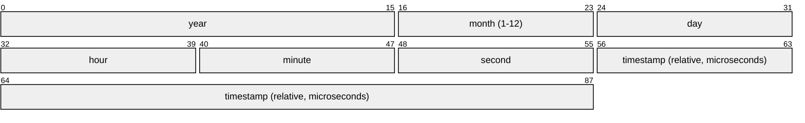
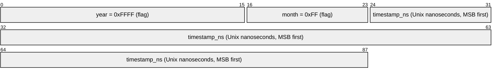
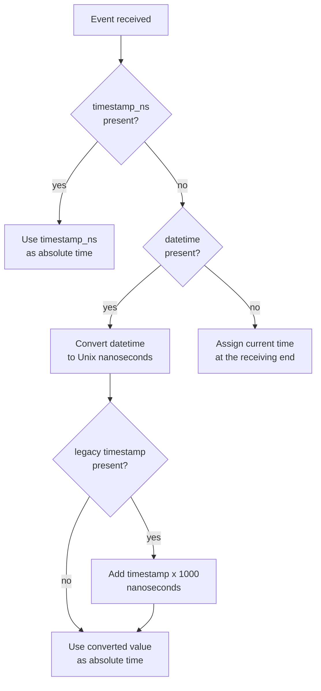

# VSCP Timestamps

## Overview

VSCP originally used a 32-bit `timestamp` field to represent the time between events from a device. This value was relative: if one event had a larger `timestamp` than another event from the same device, one could conclude that it was sent later. The value could not be compared between devices because the devices did not share a common time base. Only the difference between timestamps was meaningful.

An ISO 8601 `datetime` field was later added so that a device or sensor could report an absolute time. The value uses UTC and is written, for example, as `2026-08-21T16:03:00Z`. Before this field was introduced, the receiving host had to assign the event's absolute time when it received the event.

The original `timestamp` field was limited to 32 bits because many devices could not efficiently handle 64-bit values. Adding the `datetime` field preserved backward compatibility while allowing events to carry an absolute time.

## Timestamp fields

Modern VSCP implementations SHOULD use `timestamp_ns`, a 64-bit Unix timestamp with nanosecond resolution. It is a separate field from the legacy `timestamp` field:

| Field | Meaning | Type |
| --- | --- | --- |
| `timestamp` | Legacy relative time between events from the same device, in microseconds. | 32-bit unsigned integer |
| `datetime` | Legacy absolute event time in UTC, represented as an ISO 8601 string. | String |
| `timestamp_ns` | Absolute Unix time in nanoseconds since `1970-01-01 00:00:00 UTC`. | 64-bit unsigned integer |

`timestamp_ns` combines the absolute time represented by `datetime` with the relative offset represented by `timestamp`. It does not replace the legacy `timestamp` field by reusing its name.

The value of `timestamp_ns` MUST be represented as a 64-bit integer. In JavaScript, use a `BigInt` or a string to preserve precision. A legacy relative timestamp in microseconds can be converted to nanoseconds by multiplying it by `1,000`.

The `datetime` and `timestamp` fields remain supported for backward compatibility. New software SHOULD send `timestamp_ns` instead.

## Binary time block

For lower-end software using the [vscp.h definitions](https://github.com/grodansparadis/vscp/blob/98a026b16149057f504902c5a7f6ed9ab52456fd/src/vscp/common/vscp.h#L97-L117), the compatible time block is:

```c++
/*
    Time block. All values are UTC.
    If all fields are zero, set the current time at the receiving end.

    If year is 0xffff and month is 0xff, the eight bytes starting at
    the day field contain timestamp_ns, MSB first.
*/
uint16_t year;  /* 0xffff selects timestamp_ns */
uint8_t month;  /* 1-12; 0xff when timestamp_ns is used */

union {
  uint64_t timestamp_ns; /* Unix timestamp with nanosecond precision */
  struct {
    uint8_t day;        /* 1-31 */
    uint8_t hour;       /* 0-23 */
    uint8_t minute;     /* 0-59 */
    uint8_t second;     /* 0-59 */
    uint32_t timestamp; /* Relative event time in microseconds */
                        /* Rolls over after approximately 71 minutes */
                        /* If zero, set relative time at the receiver */
  };
};
```

When `timestamp_ns` is used, `year` and `month` act as flags and do not contain datetime values. When the legacy representation is used, `day`, `hour`, `minute`, `second`, and `timestamp` contain the UTC date and relative time information.

The two interpretations of the time block look like this. Legacy representation:



When `year` is 0xFFFF and `month` is 0xFF:



## Conversion rules

When **receiving** an event:

1. If `timestamp_ns` is present, use it as the event's absolute time.
2. Otherwise, if `datetime` is present, convert it to Unix nanoseconds.
3. If a legacy `timestamp` is also present, convert it from microseconds to nanoseconds by multiplying it by `1,000`, then add it to the converted `datetime`.
4. For example, a `timestamp` of `1,000,000` adds one second to the `datetime`. Larger values may add multiple seconds.
5. If no absolute time is supplied, assign the current time at the receiving end as required by the relevant protocol.

When **sending** an event, new software SHOULD use `timestamp_ns`. Receivers MUST continue to accept the legacy `datetime` and `timestamp` fields for backward compatibility.



## String format

The legacy string format uses `timestamp`:

```text
head,class,type,obid,datetime,timestamp,GUID,data1,data2,data3....
```

The new string format uses `timestamp_ns` in its own field position:

```text
head,class,type,obid,,timestamp_ns,GUID,data1,data2,data3....
```

For new events, `datetime` and the legacy `timestamp` are deprecated and SHOULD be left blank or omitted according to the applicable string-format version. When receiving an event string, the receiver MUST use the applicable protocol version or context to distinguish the legacy relative `timestamp` from the absolute `timestamp_ns`.

## JSON format

The JSON event format is commonly used for MQTT and other integrations. An event is represented as follows:

```json
{
  "head": 2,
  "obid": 123,
  "datetime": "2017-01-13T10:16:02Z",
  "timestamp": "0x50817",
  "class": 10,
  "type": 8,
  "guid": "00:00:00:00:00:00:00:00:00:00:00:00:00:01:00:02",
  "data": [1, 2, 3, 4, 5, 6, 7],
}
```

For new JSON events, use `timestamp_ns` as a separate property and omit the legacy `datetime` and `timestamp` properties unless they are needed for compatibility:

```json
{
  "head": 2,
  "obid": 123,
  "timestamp_ns": "1755792180000000000",
  "class": 10,
  "type": 8,
  "guid": "00:00:00:00:00:00:00:00:00:00:00:00:00:01:00:02",
  "data": [1, 2, 3, 4, 5, 6, 7]
}
```

A JavaScript `Number` can represent integers exactly only up to `Number.MAX_SAFE_INTEGER`, $2^{53} - 1$ (approximately `9,007,199,254,740,991`). A full 64-bit value can be as large as $2^{64} - 1$ (approximately `1.8 x 10^19`) and will lose precision if stored as a regular `Number`. Values within the safe integer range may be stored as numbers.

## XML format

XML uses the following event format:

```xml
<event
    head="3"
    obid="1234"
    datetime="2017-01-13T10:16:02Z"
    timestamp="50817"
    class="10"
    type="6"
    guid="00:00:00:00:00:00:00:00:00:00:00:00:00:00:01:00:02"
  sizedata="7"
  data="0x48,0x34,0x35,0x2E,0x34,0x36,0x34" />
```

For new XML events, `datetime` and `timestamp` retain their legacy meanings and are deprecated. Add a separate `timestamp_ns` attribute for the 64-bit Unix timestamp with nanosecond resolution:

```xml
<event
  head="3"
  obid="1234"
  timestamp_ns="1755792180000000000"
  class="10"
  type="6"
  guid="00:00:00:00:00:00:00:00:00:00:00:00:00:01:00:02"
  sizedata="7"
  data="0x48,0x34,0x35,0x2E,0x34,0x36,0x34" />
```

A `0x` prefix is allowed for numeric values, as it is for other VSCP values in the XML event structure.

## Binary protocol

For the [binary protocol](https://grodansparadis.github.io/vscp-doc-spec/#/./vscp_over_binary), used over UDP, multicast, serial streams, and similar transports, a new frame format with `type = 1` has been introduced. This frame type uses only `timestamp_ns`.

Receivers MUST support both frame types and apply the conversion rules above when converting them to VSCP events. New transmitters SHOULD send only `type = 1` frames.

[filename](./bottom_copyright.md ':include')