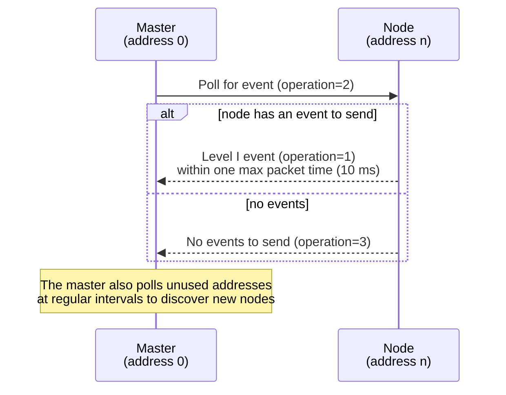
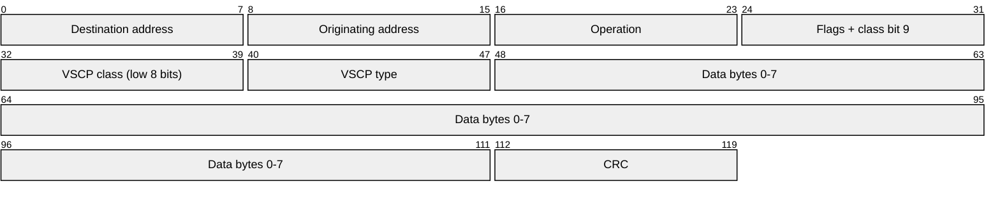

# VSCP Level I over RS-485/RS-422

This is a description of a low level protocol for RS-485. The protocol is a server based protocol and is low speed but very cheap to implement. At a very low additional cost a CAN network with full VSCP functionality and server less functionality can be constructed and this is recommended for the majority of systems.

**Baudrate:** 115200 (or any other suitable Baudrate) 
**Format:** 8N1 for packages. 9N1 for address.

### Addressing

Addressing is done with nine bit addressing. Address 0 is reserved for the server and the rest of the addresses are free to use for clients. Addresses are hard-coded within devices and each device should have its own unique address. Nine bit addressing is described here [http://electronicdesign.com/embedded/use-pcs-uart-9-bit-protocols](http://electronicdesign.com/embedded/use-pcs-uart-9-bit-protocols)

### Packet format

If a node has a event to send it sends it directly after the poll event. The node should respond within one maximum packet time (14 * 8 * 104uS = 10 ms. Note that the event may be addressed to another node on the segment not only to the host.

If the node has no events to send it can either not reply to the poll or reply with “No Events to send” which is the preferable way.

The events is standard VSCP Level I events in every other aspect.

A master on a RS-485 segment must check for new nodes on regular intervals. With 127 possible nodes this process could take 1.3 seconds to perform. Instead of doing all this at once it may be better to spread it over the standard polling range. That is to do a full polling of all active nodes and then try to discover a new node on an unused address etc etc. 

##### Frame format

 | Byte | Content                                              | 
 | :----: | :-------                                           | 
 | 0    | Nine bit destination address                         | 
 | 1    | Originating address (master=0)                       | 
 | 2    | Operation (see below)                                | 
 | 3    | Flags + bit nine of the class ( see below)           | 
 | 4    | VSCP Class (Lower 8 bits).                           | 
 | 5    | VSCP Type                                            | 
 | 6    | Data byte 0                                          | 
 | 7    | Data byte 1                                          | 
 | 8    | Data byte 2                                          | 
 | 9    | Data byte 3                                          | 
 | 10   | Data byte 4                                          | 
 | 11   | Data byte 5                                          | 
 | 12   | Data byte 6                                          | 
 | 13   | Data byte 7                                          | 
 | 14   | Packet CRC (counted from address (low 8-bits of it). | 

The DOW checksum is used. [https://www.vscp.org/wiki/doku.php?id=vscp_specification_crc_polynoms.](https://www.vscp.org/wiki/doku.php?id=vscp_specification_crc_polynoms.)

##### Operations

 | Operation code | Description                                            | 
 | :--------------: | :-----------                                            | 
 | 0              | No operation                                           | 
 | 1              | Level I event to/from node.                            | 
 | 2              | Poll for event. (No data content follows, just CRC).   | 
 | 3              | No events to send (No data content follows, just CRC). | 

##### Flags

 | Bit | Description                      | 
 | :---: | :-----------                   | 
 | 0-3 | Number of data-bytes             | 
 | 4   | Bit nine of Class.               | 
 | 5-7 | reserved and should be set to 0. | 

## Work in progress: V1 clarification proposal

**Status: experimental and non-normative.** This section records a candidate interpretation for implementation and interoperability testing. It does not replace or silently amend the existing description above. Do not claim compatibility with deployed VSCP devices until the open questions below have been checked against existing firmware or captured bus traffic.

### Provisional UART and frame interpretation

- The first UART character is a nine-bit destination word. The candidate interpretation treats bit 8 as an address marker and bits 0–7 as a numeric address from 0 to 127. All following characters are eight-bit data.
- The candidate EVENT frame contains a destination word, source, operation, flags, class low byte, type, 0–8 data bytes, and CRC: `7 + data_length` UART characters in total.
- The candidate POLL and NO_EVENTS short frames each contain four characters: destination word, source, operation, and CRC. Flags, class, type, and data are omitted.
- For EVENT, flags bits 0–3 carry data length, bit 4 carries class bit 8, and bits 5–7 are zero. Class is 0–511 and type is 0–255.
- The prototype CRC is CRC-8/MAXIM-DOW (reflected polynomial `0x8c`, initial value 0, final XOR 0). It covers the low eight bits of the destination followed by the remaining frame bytes before the CRC; the ninth address marker is not included.
- The coordinator polls nodes; an addressed node may return one event or NO_EVENTS in its response slot. Nodes do not send unsolicited frames on a shared half-duplex bus.

These are software-prototype assumptions, **not verified wire-level requirements**. In particular, the CRC check string `123456789 -> A1` checks only the CRC algorithm, not legacy VSCP CRC coverage or frame compatibility.

### Decisions required before normative publication

Confirm the ninth-bit meaning and address filtering, short-frame layout, CRC parameters and byte coverage against deployed firmware. Define legal/reserved addresses and duplicate-address handling; response deadlines and turnaround timing for each supported UART/transceiver; frame recovery after timeout or UART errors; and separate physical profiles for half-duplex RS-485 and full-duplex RS-422. GUID mapping and event delivery/queue semantics also remain to be specified.

The Linux UART capability probe and backend limitations are described in [the RS-485 UART backend proposal](./proposals/rs485-linux-uart-backends.md). A positive ioctl capability report does not establish nine-bit VSCP interoperability. Promote this proposal into the normative specification only after independent golden vectors and physical tests pass.

[filename](./bottom_copyright.md ':include')

