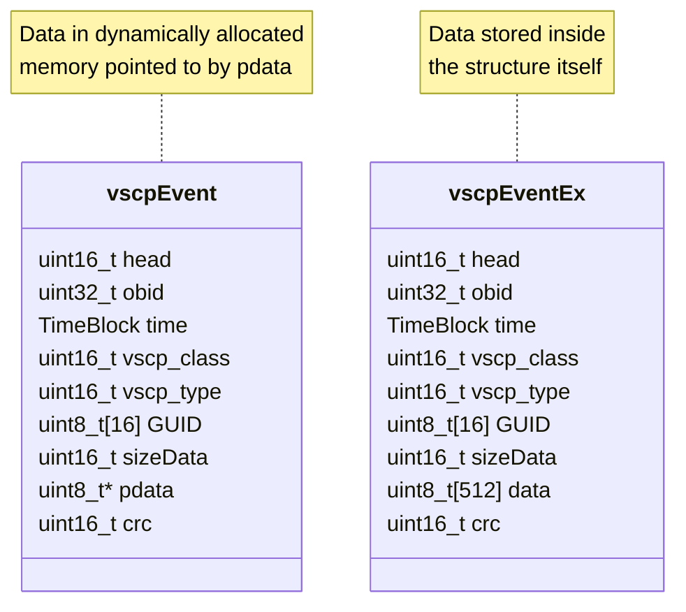
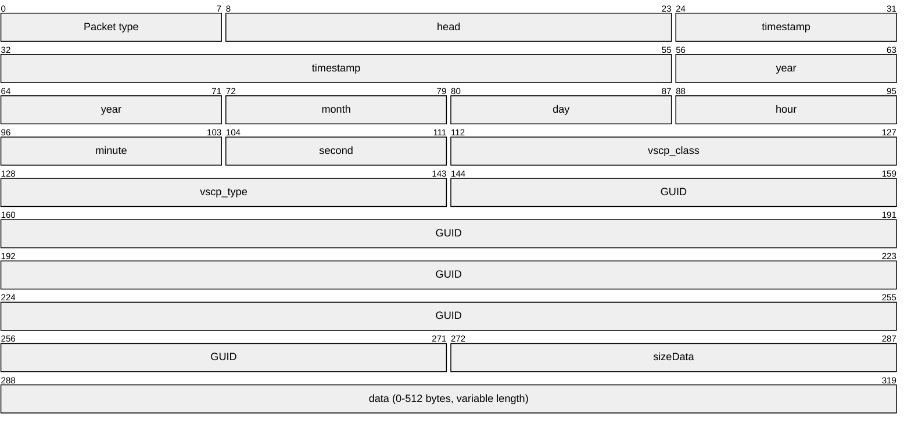

# VSCP Level II Specifics

See also [VSCP over TCP/IP](./vscp_over_tcp_ip.md), which defines additional Level II details for lower-level implementations.

Level II nodes are intended for higher-bandwidth media than Level I nodes. Level II does not use the Level I nickname procedure; consequently, the full 16-byte GUID is included in every event.

## Level II events

The Level II event is defined in two forms. `vscpEvent` stores the event data in dynamically allocated memory, while `vscpEventEx` stores the data within the structure itself.

```c++
typedef struct _vscpEvent {

  /*
      Bit 15 - This is a dumb node. No MDF, register, nothing.
      Bit 14 - GUID type
      Bit 13 - GUID type
      Bit 12 - GUID type (GUID is IP v.6 address if set and 13/14 is zero.)
      Bit 8-11 = Reserved
      Bits 5-7 = priority, 0-7 where 0 is the highest priority.
      Bit 4 = hard coded, true for a hard coded device.
      Bit 3 = Don't calculate CRC, false for CRC usage.
            Just checked when CRC is used.
            If set the CRC should be set to 0xAA55 for
            the event to be accepted without a CRC check.
      Bit 2 = Rolling index.
      Bit 1 = Rolling index.
      Bit 0 = Rolling index.
  */
  uint16_t head;

  /* ----- CRC should be calculated from here to end + data block ----  */

  uint32_t obid; /* Used by driver for channel info etc. */

  /*
    Time block - Always UTC. If all fields are zero, set the current time at
    the receiving end.

    If year is 0xffff, the eight bytes starting at the day field contain a
    Unix timestamp with nanosecond precision, MSB first.
  */
  uint16_t year;
  uint8_t month; /* 1-12; 0xff when timestamp_ns is used */

  union {
    uint64_t timestamp_ns; /* Unix timestamp in nanoseconds (when year == 0xffff) */
    struct {
      uint8_t day;        /* 1-31 */
      uint8_t hour;       /* 0-23 */
      uint8_t minute;     /* 0-59 */
      uint8_t second;     /* 0-59 */
      uint32_t timestamp; /* Legacy relative event time in microseconds */
              /* Rolls over after approximately 71 minutes */
              /* If zero, set relative time at the receiver */
    };
  };

  uint16_t vscp_class; /* VSCP class */
  uint16_t vscp_type;  /* VSCP type */
  uint8_t GUID[16];    /* Node globally unique id MSB(0) -> LSB(15) */
  uint16_t sizeData;   /* Number of valid data bytes */

  uint8_t *pdata; /* Pointer to data. Max 512 bytes */

  uint16_t crc; /* Used for UDP/Ethernet etc */

} vscpEvent;

typedef vscpEvent *PVSCPEVENT;
```

and in a version where the data is included in the struct

```c++
typedef struct _vscpEventEx {

  /*
      Bit 15 - This is a dumb node. No MDF, register, nothing.
      Bit 14 - GUID type
      Bit 13 - GUID type
      Bit 12 - GUID type (GUID is IP v.6 address if set and 13/14 is zero.)
      Bit 8-11 = Reserved
      Bit 765 =  priority, Priority 0-7 where 0 is highest priority.
      Bit 4 = hard coded, true for a hard coded device.
      Bit 3 = Don't calculate CRC, false for CRC usage.
            Just checked when CRC is used.
            If set the CRC should be set to 0xAA55 for
            the event to be accepted without a CRC check.
      Bit 2 = Rolling index.
      Bit 1 = Rolling index.
      Bit 0 = Rolling index.
  */
  uint16_t head;

  /* CRC should be calculated from here to end + data block */

  uint32_t obid; /* Used by driver for channel info etc. */

  /*
    Time block - Always UTC time. I all zero set current time on receiving end

    If year is set to 0xffff a unix UTC timestamp with nanosecond precision is formed by the eight
    byte buffer starting at the day field MSB first.
  */
  uint16_t year;
  uint8_t month; /* 1-12 */

  union {
    uint64_t timestamp_ns; /* Unix timestamp with nanosecond precision (when year == 0xffff) */
    struct {
      uint8_t day;        /* 1-31 */
      uint8_t hour;       /* 0-23 */
      uint8_t minute;     /* 0-59 */
      uint8_t second;     /* 0-59 */
      uint32_t timestamp; /* Relative time stamp for package in microseconds */
                          /* ~71 minutes before roll over */
                          /* If all zero set relative time on receiving end */
    };

  };

  uint16_t vscp_class; /* VSCP class   */
  uint16_t vscp_type;  /* VSCP type    */
  uint8_t GUID[16];    /* Node globally unique id MSB(0) -> LSB(15)    */
  uint16_t sizeData;   /* Number of valid data bytes   */

  uint8_t data[VSCP_MAX_DATA]; /* Pointer to data. Max. 512 bytes     */

  uint16_t crc; /* Used for UDP/Ethernet etc */

} vscpEventEx;

typedef vscpEventEx *PVSCPEVENTEX;
```

The main differences from Level I are that the full GUID is sent with each event, and both the class and type fields are 16 bits wide.

The two structures hold the same information and only differ in how the data block is stored:



The CRC is calculated using the CCITT polynomial.

The stream format is described in the relevant transport specification.


## VSCP LEVEL II UDP datagram offsets

```c++
#define VSCP_MULTICAST_PACKET0_POS_PKTTYPE              0

#define VSCP_MULTICAST_PACKET0_POS_HEAD                 1
#define VSCP_MULTICAST_PACKET0_POS_HEAD_MSB             1

#define VSCP_MULTICAST_PACKET0_POS_HEAD_LSB             2
#define VSCP_MULTICAST_PACKET0_POS_TIMESTAMP            3

#define VSCP_MULTICAST_PACKET0_POS_YEAR                 7
#define VSCP_MULTICAST_PACKET0_POS_YEAR_MSB             7

#define VSCP_MULTICAST_PACKET0_POS_YEAR_LSB             8
#define VSCP_MULTICAST_PACKET0_POS_MONTH                9

#define VSCP_MULTICAST_PACKET0_POS_DAY                  10
#define VSCP_MULTICAST_PACKET0_POS_HOUR                 11

#define VSCP_MULTICAST_PACKET0_POS_MINUTE               12
#define VSCP_MULTICAST_PACKET0_POS_SECOND               13

#define VSCP_MULTICAST_PACKET0_POS_VSCP_CLASS           14
#define VSCP_MULTICAST_PACKET0_POS_VSCP_CLASS_MSB       14

#define VSCP_MULTICAST_PACKET0_POS_VSCP_CLASS_LSB       15
#define VSCP_MULTICAST_PACKET0_POS_VSCP_TYPE            16

#define VSCP_MULTICAST_PACKET0_POS_VSCP_TYPE_MSB        16
#define VSCP_MULTICAST_PACKET0_POS_VSCP_TYPE_LSB        17

#define VSCP_MULTICAST_PACKET0_POS_VSCP_GUID            18
#define VSCP_MULTICAST_PACKET0_POS_VSCP_SIZE            34

#define VSCP_MULTICAST_PACKET0_POS_VSCP_SIZE_MSB        34
#define VSCP_MULTICAST_PACKET0_POS_VSCP_SIZE_LSB        35

#define VSCP_MULTICAST_PACKET0_POS_VSCP_DATA            36
```

The datagram layout (bit offsets shown, divide by eight for the byte offsets listed above):



The `obid` and time fields are not present in this datagram layout. They are inserted by the driver or interface software when the datagram is converted to a VSCP event.

Level I events can travel through a Level II network because Level I events are represented in Level II using class 1024. Since nicknames are not available in Level II, the nickname is replaced by the full GUID. This is useful in larger installations.

When a Level I event is transferred to Level II, the event may use either the originating node's GUID or the interface's GUID. The implementer may choose either approach, provided that the GUIDs remain unique and the chosen policy is consistent.

For an interface, the machine's MAC address, when available, is a useful basis for a GUID because it can be mapped to the physical nodes managed by that interface. This approach provides 65,536 unique GUIDs per MAC address.

Other methods for generating GUIDs are described in [Globally Unique Identifiers](https://grodansparadis.github.io/vscp-doc-spec/#/./vscp_globally_unique_identifiers).

## String representation

A compact string representation is used, for example, by the [VSCP TCP/IP link protocol](./vscp_over_tcp_ip.md).

The current format is:

```
head,class,type,obid,,timestamp_ns,GUID,data1,data2,data3....
```

The legacy format is:

```
head,class,type,obid,datetime,timestamp,GUID,data1,data2,data3....
```

In the legacy format, `datetime` is an ISO 8601 UTC date and time in the form `YYYY-MM-DDTHH:MM:SS[.ssss[Z]]`. It is deprecated in new implementations and should be left blank.

`obid`, `datetime`, and the legacy `timestamp` may be omitted. The field positions are retained by leaving the corresponding fields empty.

Modern software should use `timestamp_ns`, a separate 64-bit Unix timestamp with nanosecond resolution. The legacy `datetime` and `timestamp` fields are left blank when `timestamp_ns` is present.

If `datetime` and `timestamp_ns` are both absent, the first interface that receives the event should set `timestamp_ns` to the current UTC time.

If `timestamp_ns` is absent but `datetime` is present, the receiver should convert `datetime` to `timestamp_ns`. A legacy `timestamp`, when present, is a relative microsecond offset and may be added after conversion according to the timestamp rules.

The GUID can either be the full GUID on the form

```
25:00:00:00:00:00:00:00:00:00:00:00:0D:02:00:01
```

or a dash

```
-
```

or empty. If it is a dash or is empty the GUID of the interface is set for the event.

All numeric fields except GUID components may be decimal or hexadecimal. GUID components are always hexadecimal and do not use a `0x` prefix. Other hexadecimal numbers should use the `0x` prefix.

## XML representation

VSCP Level II events can also be represented as XML:

```xml
<?xml version = "1.0" encoding = "UTF-8" ?>
<!-- Version 0.0.2 2020-02-20 -->
<event 
    vscpHead="flags for event"
    vscpClass="Event class is numerical form or CLASSx:numerical form"
    vscpType="Event type in numerical form."
    vscpGuid="ff:ee:dd:cc:bb:aa:99:88:77:66:55:44:33:22:11:00"
    vscpTimeStamp="Legacy relative microsecond value."
    vscpDateTime="Legacy ISO 8601 UTC date and time."
    timestamp_ns="Unix timestamp in nanoseconds."
    vscpData="
    Comma separated list with event data. Hex values (preceded with '0x')and decimal values allowed."
    unit="Code for unit data is presented in"
    sensorindex="Index for sensor"
    coding="How value is codes"
    value="Measurement value"
    note="Some note about this event"
/>
```

`unit`, `sensorindex`, `coding`, and `value` are optional fields used by event-decoding software. `note` is used by analytical software such as VSCP Works.

If `timestamp_ns`, `vscpTimeStamp`, and `vscpDateTime` are absent, the event time should be set to the current time at the receiving end.

`vscpTimeStamp` is a sender-relative value in microseconds. It is retained for backward compatibility and is not the same as `timestamp_ns`.

`vscpDateTime` is a legacy UTC date and time in ISO 8601 format.

Defaults for absent fields are described in the JSON section below.

## JSON representation

VSCP Level II events can be represented as JSON. The current format is:

```json
{
  "head": 0,
  "obid": 0,
  "class": 10,
  "type": 6,
  "guid": "ff:ee:dd:cc:bb:aa:99:88:77:66:55:44:33:22:11:00",
  "timestamp_ns": "1755792180000000000",
  "data": [1, 2, 3, 4],
  "note": "Some optional note about event",
  "measurement": {
    "value": 1.2345,
    "unit": 0,
    "sensorindex": 0,
    "zone": 0,
    "subzone": 0
  }
}
```

The following property names are deprecated but remain supported for compatibility:

```json
{
  "vscpHead": 0,
  "vscpObId": 0,
  "vscpClass": 10,
  "vscpType": 6,
  "vscpGuid": "ff:ee:dd:cc:bb:aa:99:88:77:66:55:44:33:22:11:00",
  "vscpTimeStamp": 1234567,
  "vscpDateTime": "2018-03-03T12:01:40Z",
  "vscpData": [1, 2, 3, 4],
  "vscpNote": "Some optional note about event",
  "measurement": {
    "value": 1.2345,
    "unit": 0,
    "sensorindex": 0,
    "zone": 0,
    "subzone": 0
  }
}
```
`vscpNote` is used by analytical software such as VSCP Works for log files and other diagnostic event logs.

`unit`, `sensorindex`, `coding`, and `value` are optional measurement-conversion fields.

The measurement block is optional. It may be added by software that decodes measurements, but consumers must not assume that it is present.

If `timestamp_ns`, `vscpTimeStamp`, and `vscpDateTime` are absent, the event time should be set to the current time at the receiving end.

`vscpTimeStamp` is a legacy sender-relative value in microseconds. It is deprecated. The current `timestamp_ns` property is a separate 64-bit Unix timestamp with nanosecond resolution.

`vscpDateTime` is a legacy UTC date and time in ISO 8601 format.

If a property is not present, it should be interpreted as zero unless otherwise specified. The exceptions are the time fields described above, `vscpGuid`, and `vscpData`.

Higher level software may use

```json
{
  "vscpClassToken": "VSCP_CLASS1_MEASUREMENT",
  "vscpTypeToken": "VSCP_TYPE_MEASUREMENT_ELECTRIC_CURRENT"
}
```
or similar for more user-friendly class and type information. These tokens should be provided in addition to the numeric values, not instead of them.

### Defaults for absent fields

When bandwidth is constrained, fields may be omitted. If a field is omitted, the following defaults apply:

  * `head` defaults to zero.
  * `obid` defaults to zero.
  * `guid` defaults to all zeros. It may be omitted if the MQTT topic contains the GUID.
  * `vscpTimeStamp` defaults to zero because it is a legacy field.
  * `timestamp_ns` defaults to the current UTC time at the receiving end.
  * `vscpDateTime` is deprecated and defaults to absent.
  * `vscpClass` and `vscpType` default to zero. They may be omitted if the MQTT topic contains one or both values.
  * `data` is empty if omitted.
  * `vscpNote` defaults to an empty string.

For example, consider a device that reports on/off events. The VSCP events are:

  * [CLASS1.INFORMATION, type 3, On](https://grodansparadis.github.io/vscp-doc-spec/#/./class1.information?id=type3)
  * [CLASS1.INFORMATION, type 4, Off](https://grodansparadis.github.io/vscp-doc-spec/#/./class1.information?id=type4)

The data for each event contains:

  * index
  * zone
  * subzone

An MQTT topic can then use the following form:

   .../'GUID'/'class'/'type'/'index'/'zone'/'subzone'

or typically

    vscp/25:00:00:00:00:00:00:00:00:00:00:00:06:01:00:01/20/+/1/2/3/#

This allows the client to construct the complete event even when the message payload contains only minimal data.


## Globally unique identifiers

Every node in a VSCP network must have a globally unique 16-byte (128-bit) identifier. This GUID identifies the device and can be used to locate its device description and platform-specific drivers.

The manufacturer may also use the GUID as a serial number. Unlike many other environments and protocols, VSCP allows GUIDs to be generated from commonly available identifiers. For example, an Ethernet MAC address can be used as the basis for a GUID.

In Level I communication, the GUID is normally replaced by an 8-bit address to reduce protocol overhead. A segment can contain up to 127 nodes, although the address field can represent 256 values. The address is assigned by a master node called the segment controller and is also known as the node nickname or nickname address.

In addition to a GUID, each node should provide a node-description URL in its firmware. The URL can describe the node and its device family, and can link to drivers for operating systems or segment-controller environments.

Some GUIDs are reserved and unavailable for assignment. The [assigned GUIDs](./assigned_guids.md) page lists reserved and assigned ranges.

The VSCP team allocates other address ranges to individuals and companies upon request at [guid_request@vscp.org](mailto:guid_request@vscp.org). A 32-bit range can identify up to 4,294,967,296 devices. There is no cost to reserve a range. The [assigned GUIDs](./assigned_guids.md) page contains the current allocation list.

## Predefined VSCP GUIDs

It is possible to create a valid global VSCP GUID without requesting an allocated range. Some GUID ranges are derived from Ethernet MAC addresses and other common identifier series. See the [full list](./vscp_globally_unique_identifiers.md).

## Assigned VSCP GUIDs

Current predefined GUID ranges are listed on the [assigned GUIDs](./assigned_guids.md) page. You can request your own range by contacting [guid_request@vscp.org](mailto:guid_request@vscp.org).

## Shorthand GUIDs

The shorthand notation `::` can be used as a placeholder for zero-valued GUID components. For example:

    ::1

really means

    00:00:00:00:00:00:00:00:00:00:00:00:00:00:00:01

Similarly:

    FF:21::22:32

is the same as

    FF:21:00:00:00:00:00:00:00:00:00:00:00:00:22:32

The notation `*:` can be used as a placeholder for `FF` values:

*:1 really means

    FF:FF:FF:FF:FF:FF:FF:FF:FF:FF:FF:FF:FF:FF:FF:01

These shorthand notations make GUIDs easier to write.

[filename](./bottom_copyright.md ':include')
