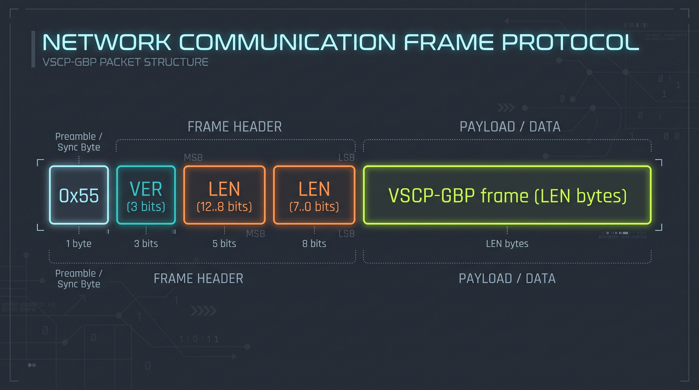
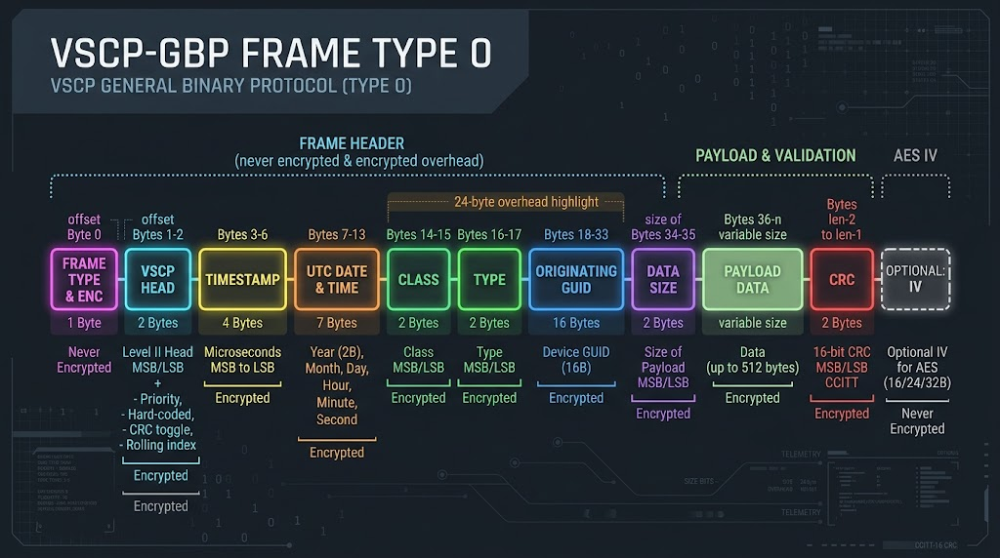
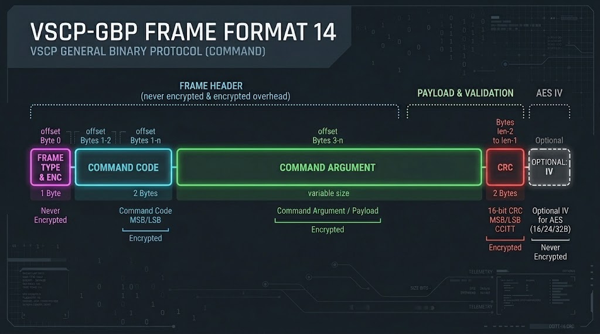
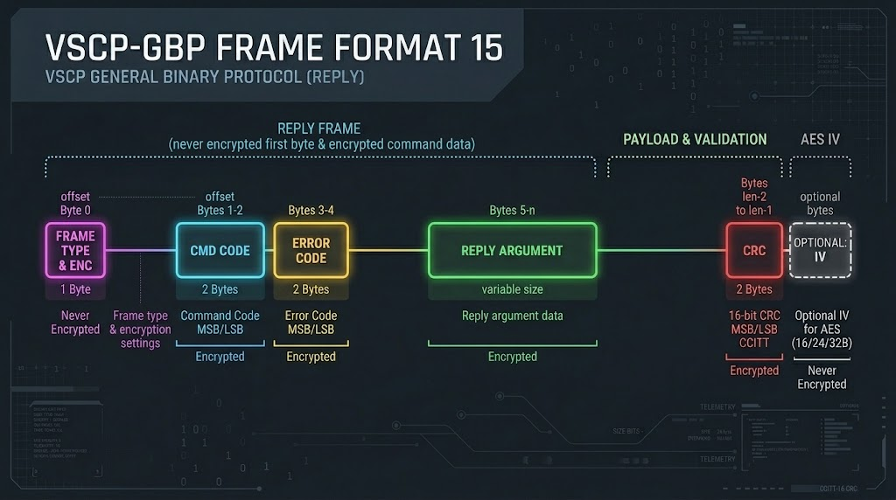

# VSCP general binary protocol (VSCP-GBP)

The VSCP binary protocol is designed to be used on different types of transports such as TCP, UDP, Multicast, serial, etc. The protocol is designed to be simple and efficient for sending VSCP events and commands between devices.

Encryption is available, but optional. When used it can be AES-128, AES-192 or AES-256 in CBC mode. The event body, including its CRC and PKCS#7 padding, is encrypted; the first byte containing the frame type and encryption settings remains clear. The shared secret encryption key is 128/192/256 bits long. The CRC is calculated on the plaintext body before encryption and detects accidental corruption; it does not provide cryptographic integrity. Version 1 adds HMAC-SHA256 authentication. AES always has a 16-byte block size and 16-byte IV, regardless of key length. Encryption overhead consists of 1-16 padding bytes plus the 16-byte IV; authenticated packets additionally carry the prefix and 16-byte tag described below.

Encrypting frames has the advantage over TLS that it can be used on any transport and that it can be used in a peer-to-peer manner without the need for a client-server architecture. It also allows for end-to-end encryption between devices without the need for a secure tunnel between them. The disadvantage is that it does not provide integrity protection and that it requires a shared secret key which can be difficult to manage in large deployments. The main advantage is the simplicity and flexibility of the protocol which allows it to be used in a wide range of applications and scenarios and abovove all no need to update certificates on devices.

On higher end systems use TLS/SSL. On lower end systems this protocol might be an alternative.

It's important to distinguish between the frame format/type and the VSCP frame type. The frame format/type is defined by the first byte of a frame and indicates the type of frame and the encryption settings. The VSCP frame type is defined by the bits 8/9 in the VSCP header and indicates the type of event and the format of the timestamp. The difference between the two is:

  * **VSCP Frame type = 0** Frame type 0 has a timestamp in microseconds since the epoch (GMT) and seperate bytes that defines the time for year/month/day/hour/minute/second. This is the original binary frame type and should normally not be useed anymore. It is kept for backward compatibility reasons.
  * **VSCP Frame type = 1** Frame type 1 has a timestamp in nanoseconds since the epoch (GMT) and reserved bytes for future use. Year/month/day/hour/minute/second can be calculated from the timestamp if needed. This is the recommended frame format for current implementations.

## Frame prefix used on transports such as tcp/ip UDP, Multicast etc



For stream framing, a prefix consisting of the sync byte 0x55 and a two-byte big-endian version/length word is added before the inner frame. The three most significant **bits** of that word are the packet version; the remaining 13 bits are the length of everything after the prefix, including type, ciphertext/plaintext, IV and tag where present. The prefix itself is not counted. Versions 0 and 1 are described below.

The current VSCP UDP driver uses no prefix for unauthenticated datagrams and requires the version-1 prefix for HMAC-authenticated datagrams. A transport's framing rules must therefore be agreed by both endpoints; do not assume every UDP datagram has a prefix.

To sync on a steam look for the preample and if found try to decrypt and crc check the frame. On failure look for next preamble until synced.

This is used for vscp-gbp over tcp/ip

The packet version has the following 

| version | description |
|---------|-------------|
| 0 | Legacy format |
| 1 | With HMAC-SHA-256. A truncated 16-byte HMAC is at the the end of the frame after the IV. |
| 2 | Reserved |
| 3 | Reserved |

HMAC is never used for non encrypted frames.

### Version 0

| 0x55 | length (2 bytes) | encrypted-frame | IV |

### Version 1 HMAC
The HMAC is truncated to its leftmost 128 bits (16 bytes). It is calculated over the three-byte prefix, the clear type byte, the ciphertext and the IV, and placed after the IV. The length in the authenticated prefix includes the tag. The tag itself is excluded from its HMAC input.

| 0x55 | length (2 bytes) | encrypted-frame | IV (16 bytes) | HMAC (16 bytes) |

### Byte-by-byte event packet layouts

All offsets below are zero-based, in bytes, and inclusive. Multi-byte integers
are big-endian (most significant byte first). These layouts describe event
frames 0 and 1, not command/reply frames 14 and 15.

Notation:

- `N`: event data length, 0-512 bytes for the current Level II UDP driver.
- `F = 38 + N`: length of the complete unencrypted inner event frame.
- `B = F - 1 = 37 + N`: event body length, including CRC but excluding type.
- `P = 16 - (B mod 16)`: number of PKCS#7 padding bytes, always 1-16.
- `C = B + P = 16 * (floor(B / 16) + 1)`: ciphertext length.
- `T = (frame_format << 4) | encryption`: clear type byte.

For frame format 1, `T` is `0x10` (plain), `0x11` (AES-128),
`0x12` (AES-192) or `0x13` (AES-256). For legacy format 0 the corresponding
values are `0x00`, `0x01`, `0x02` and `0x03`. Packet prefix version 0/1 is
independent of event frame format 0/1.

#### Unencrypted event: exact inner-frame offsets

This is also the complete unauthenticated plaintext UDP payload: no prefix,
padding, IV or HMAC tag is present.

| Offset | Bytes | Field | Value / byte order |
|--------|-------|-------|--------------------|
| 0 | 1 | Type | `0x10` for format 1, `0x00` for format 0; low nibble zero. |
| 1 | 1 | Head MSB | Header bits 15-8. |
| 2 | 1 | Head LSB | Header bits 7-0. |
| 3 | 1 | Timestamp | Format 1: bits 63-56. Format 0: microsecond timestamp bits 31-24. |
| 4 | 1 | Timestamp | Format 1: bits 55-48. Format 0: bits 23-16. |
| 5 | 1 | Timestamp | Format 1: bits 47-40. Format 0: bits 15-8. |
| 6 | 1 | Timestamp | Format 1: bits 39-32. Format 0: bits 7-0. |
| 7 | 1 | Timestamp / year | Format 1: bits 31-24. Format 0: year MSB. |
| 8 | 1 | Timestamp / year | Format 1: bits 23-16. Format 0: year LSB. |
| 9 | 1 | Timestamp / month | Format 1: bits 15-8. Format 0: month. |
| 10 | 1 | Timestamp / day | Format 1: bits 7-0. Format 0: day. |
| 11 | 1 | Reserved / hour | Format 1: zero. Format 0: hour. |
| 12 | 1 | Reserved / minute | Format 1: zero. Format 0: minute. |
| 13 | 1 | Reserved / second | Format 1: zero. Format 0: second. |
| 14 | 1 | Class MSB | Class bits 15-8. |
| 15 | 1 | Class LSB | Class bits 7-0. |
| 16 | 1 | Type MSB | Event type bits 15-8, distinct from packet type at offset 0. |
| 17 | 1 | Type LSB | Event type bits 7-0. |
| 18 + i, i=0..15 | 16 total | GUID byte i | GUID bytes in their displayed order, from first to last. |
| 34 | 1 | Data size MSB | `N >> 8`. |
| 35 | 1 | Data size LSB | `N & 0xff`. |
| 36 + i, i=0..N-1 | N total | Data byte i | No data bytes when `N=0`. |
| 36 + N | 1 | CRC MSB | CRC bits 15-8. |
| 37 + N | 1 | CRC LSB | CRC bits 7-0. |

Format-1 timestamps are nanoseconds since the Unix epoch in UTC. The current
UDP encoder emits format 1 and sets header bits 9-8 accordingly.

The normal CRC is CRC-16/CCITT-FALSE: polynomial `0x1021`, initial value
`0xffff`, no input/output reflection, final XOR `0x0000`; the check value for
ASCII `123456789` is `0x29b1`. Calculate it over offsets **1 through 35+N**,
inclusive. Exclude type byte 0, the CRC bytes themselves, any padding, prefix,
IV and HMAC. Store the result MSB first. The CRC is part of the body encrypted
in the AES layouts below.

```text
Plain UDP payload (F = 38 + N bytes):
offset 0      1 ................................ 35  36 ...... 35+N  36+N 37+N
       [type][head | timestamp/date | class | type | GUID | N][data][CRC MSB/LSB]
```

If a transport uses version-0 stream framing for plaintext, prepend
`55 [F high] [F low]` (version bits zero). Every inner offset in the table then
moves forward by three bytes; the total packet size is `3 + F`.

#### AES without HMAC: exact datagram offsets

First form the plaintext frame above. Append `P` copies of the byte value `P`
to its body (offsets 1 through `F-1`), then AES-CBC encrypt that padded body.
Even if `B` is already a multiple of 16, append a full block of sixteen `0x10`
bytes. The type byte is not encrypted.

| Wire offset | Bytes | Field | Encrypted? |
|-------------|-------|-------|------------|
| 0 | 1 | `T`: frame format and AES selection. | No |
| 1 + j, j=0..C-1 | C total | Ciphertext byte j. | Yes |
| 1 + C + i, i=0..15 | 16 total | IV byte i, in original byte order. | No |

```text
AES UDP payload (C + 17 bytes):
[T:1][AES-CBC(head ... data | CRC | PKCS#7 padding):C][IV:16]
```

After decryption, plaintext byte at inner offset `k` is at padded-body index
`k-1`. Fields cannot be read directly at their plaintext offsets on the wire:
CBC encrypts complete blocks. The padding is encrypted too.

Use a fresh unpredictable 16-byte IV for every packet. AES-128/192/256 differ
only in key size (16/24/32 bytes), not block size, IV size or layout.

For a version-0 prefixed AES packet, let `L = C + 17` and send:

| Wire offset | Field |
|-------------|-------|
| 0 | `0x55` |
| 1 | `(L >> 8) & 0x1f` (version 0) |
| 2 | `L & 0xff` |
| 3 | `T` |
| 4 through 3+C | C ciphertext bytes |
| 4+C through 19+C | 16 IV bytes |

The total is `C + 20` bytes. The unauthenticated UDP driver uses the
**unprefixed** layout, not this prefixed stream variant.

#### AES with HMAC-SHA256: exact version-1 offsets

Let `L = 1 + C + 16 + 16 = C + 33` and `W = (1 << 13) | L`.
`L` must fit in 13 bits (`L <= 8191`). The prefix length includes the tag,
but not the three-byte prefix itself.

| Wire offset | Bytes | Field | Encrypted? | HMAC input? |
|-------------|-------|-------|------------|-------------|
| 0 | 1 | Sync `0x55`. | No | Yes |
| 1 | 1 | `W >> 8`: version bits `001` followed by length bits 12-8. | No | Yes |
| 2 | 1 | `W & 0xff`: length bits 7-0. | No | Yes |
| 3 | 1 | `T`: clear frame type and AES selection. | No | Yes |
| 4 + j, j=0..C-1 | C total | Ciphertext byte j. | Yes | Yes |
| 4 + C + i, i=0..15 | 16 total | IV byte i. | No | Yes |
| 20 + C + i, i=0..15 | 16 total | HMAC digest byte i (first 16 bytes). | No | No |

```text
Authenticated packet (C + 36 bytes):
[55][version/length:2][T:1][ciphertext:C][IV:16][tag:16]
```

Compute the full 32-byte digest with a separate 32-byte HMAC key:

```text
digest = HMAC-SHA256(hmac_key, packet[0 .. C+19])
tag    = digest[0 .. 15]
```

Thus authentication covers the prefix **including version and length**, the
clear type, all ciphertext and the IV. Compare the tag in constant time before
decryption; then verify PKCS#7 padding, declared event length and CRC. HMAC is
not used with unencrypted packets. This is the authenticated UDP layout used
by the current driver when its `hmac` key file is configured.

#### Worked offsets for three data bytes

For format 1 with data `01 02 ff`, `N=3`, `F=41`, `B=40`, `P=8` and `C=48`.

| Representation | Wire offsets | Total bytes |
|----------------|--------------|-------------|
| Plain UDP | type 0; body 1-38; CRC 39-40 | 41 |
| Plain with version-0 prefix | prefix 0-2 (`55 00 29`); inner frame 3-43 | 44 |
| AES UDP | type 0; ciphertext 1-48; IV 49-64 | 65 |
| AES with version-0 prefix | prefix 0-2 (`55 00 41`); type 3; ciphertext 4-51; IV 52-67 | 68 |
| AES with HMAC/version 1 | prefix 0-2 (`55 20 51`); type 3; ciphertext 4-51; IV 52-67; tag 68-83 | 84 |

For the AES cases, the padded plaintext body has head at indices 0-1,
timestamp at 2-9, reserved bytes at 10-12, class at 13-14, event type at 15-16,
GUID at 17-32, data length at 33-34, data at 35-37, CRC at 38-39, and eight
`08` padding bytes at 40-47. Those are **decrypted body indices**, not wire
offsets.

An exact plaintext example (head `0100`, timestamp zero, reserved bytes zero,
class 10, event type 6, all-zero GUID, three data bytes) is:

```text
Offset  Hex bytes
00      10
01-02   01 00
03-10   00 00 00 00 00 00 00 00
11-13   00 00 00
14-15   00 0a
16-17   00 06
18-33   00 00 00 00 00 00 00 00 00 00 00 00 00 00 00 00
34-35   00 03
36-38   01 02 ff
39-40   c4 74
```

For AES-256 change the clear type to `13`, encrypt example bytes 1-40 plus
eight `08` padding bytes, then append the fresh IV. For authenticated AES-256,
prepend `55 20 51`, then append the HMAC tag after the IV. Actual ciphertext,
IV and tag bytes depend on the keys and newly generated IV; they are not fixed
protocol constants.


## Frame format & type :id=vscp-frame-format

This is the format for an asynchroniously sent or received VSCP event. The receiving end send no acknowledgement that the event has been received. The sender does not know if the event has been received or not. Other means should be used to ensure that events actually are received. For example if a [TURN-ON-event](./class1.control.md?#type5) is sent, confirm this by waiting for a corresponding [ON-event](./class1.information.md?#type3).

### VSCP frame type=0 :id=vscp-frame-type-0




If frame is of type 0 (defined by bits 8/9 of head MSB byte) the timestamp is in microseconds since the epoch (GMT).

 | Byte  | Description | Encrypted | 
 | :----:  | ----------- | :---------: | 
 | 0     | Frame type & encryption settings. | _Byte is never encrypted_ | 
 | 1     | VSCP Level II Head MSB             | Yes | 
 | 2     | VSCP Level II Head LSB             | Yes | 
 | 3     | Timestamp microseconds MSB         | Yes | 
 | 4     | Timestamp microseconds             | Yes | 
 | 5     | Timestamp microseconds             | Yes | 
 | 6     | Timestamp microseconds LSB         | Yes | 
 | 7     | Year MSB                           | Yes | 
 | 8     | Year LSB                           | Yes | 
 | 9     | Month                              | Yes | 
 | 10    | Day                                | Yes | 
 | 11    | Hour                               | Yes | 
 | 12    | Minute                             | Yes | 
 | 13    | Second                             | Yes | 
 | 14    | CLASS MSB                          | Yes | 
 | 15    | CLASS LSB                          | Yes | 
 | 16    | TYPE MSB                           | Yes | 
 | 17    | TYPE LSB                           | Yes | 
 | 18-33 | ORIGINATING GUID                   | Yes | 
 | 34    | DATA SIZE MSB                      | Yes | 
 | 35    | DATA SIZE LSB                      | Yes | 
 | 36-n  | data ... limited to max 512 bytes  | Yes | 
 | len-2 | CRC MSB (calculated over plaintext bytes 1 through 35+N; see exact layout above) | Yes |
 | len-1 | CRC LSB  | Yes | 
 | opt   | When encrypted: PKCS#7 padding is included in the ciphertext, followed by a clear 16-byte IV and, for packet version 1, a clear 16-byte HMAC tag | Padding only |

The offsets above refer to the unencrypted inner frame. Here `len = 38+N`,
not the encrypted datagram size. Prefixes shift offsets; encryption replaces
the body with ciphertext as shown in the exact layouts above.

Time should always be UTC time. If the time block is set to all zero the current time will be set by interface (VSCP Server for example).

### VSCP frame type=1 :id=vscp-frame-type-1


If VSCP frametype is of type 1 (defined by bits 8/9 of head MSB byte) the timestamp is in nanoseconds since the epoch (GMT). 

 | Byte  | Description | Encrypted | 
 | :----:  | ----------- | :---------: | 
 | 0     | Frame type & encryption settings. | _Byte is never encrypted_ | 
 | 1     | VSCP Level II Head MSB             | Yes | 
 | 2     | VSCP Level II Head LSB             | Yes | 
 | 3     | Timestamp nanoseconds MSB         | Yes | 
 | 4     | Timestamp nanoseconds             | Yes | 
 | 5     | Timestamp nanoseconds             | Yes | 
 | 6     | Timestamp nanoseconds             | Yes | 
 | 7     | Timestamp nanoseconds             | Yes | 
 | 8     | Timestamp nanoseconds             | Yes | 
 | 9     | Timestamp nanoseconds             | Yes | 
 | 10    | Timestamp nanoseconds LSB         | Yes | 
 | 11    | Reserved                           | Yes | 
 | 12    | Reserved                           | Yes | 
 | 13    | Reserved                           | Yes | 
 | 14    | CLASS MSB                          | Yes | 
 | 15    | CLASS LSB                          | Yes | 
 | 16    | TYPE MSB                           | Yes | 
 | 17    | TYPE LSB                           | Yes | 
 | 18-33 | ORIGINATING GUID                   | Yes | 
 | 34    | DATA SIZE MSB                      | Yes | 
 | 35    | DATA SIZE LSB                      | Yes | 
 | 36-n  | data ... limited to max 512 bytes for the Level II UDP driver | Yes |
 | len-2 | CRC MSB (calculated over plaintext bytes 1 through 35+N; see exact layout above) | Yes |
 | len-1 | CRC LSB  | yes | 
 | opt   | When encrypted: PKCS#7 padding is included in the ciphertext, followed by a clear 16-byte IV and, for packet version 1, a clear 16-byte HMAC tag | Padding only |

The offsets above refer to the unencrypted inner frame. Here `len = 38+N`,
not the encrypted datagram size. Prefixes shift offsets; encryption replaces
the body with ciphertext as shown in the exact layouts above.

Time should always be UTC time. If the time block is set to all zero the current time will be set by interface (VSCP Server for example).

Timestamp is nanoseconds since the epoch (GMT).

## Frame format=14 - Protocol



This frame can go both ways. It is used to send protocol commands and replies. The command/reply code is defined in the same way as the event type (16-bit) and the command/reply arguments are defined in the same way as the data field for events. The command/reply code and arguments are encrypted in the same way as for events.

 | Byte  | Description | Encrypted | 
 | :----:  | ----------- | :---------: | 
 | 0     | Frame type & encryption settings. | _Byte is never encrypted_ | 
 | 1     | Command code MSB             | Yes |
 | 2     | Command code LSB             | Yes |
 | 3-n    | command argument         | Yes |
 | len-2 | CRC MSB (Calculated over HEAD + CLASS + TYPE + ADDRESS + SIZE + DATA…) | Yes |
 | len-1 | CRC LSB  | yes |
 | opt   | AES uses a 16-byte IV for every key size; encrypted padding precedes it and a version-1 HMAC tag follows it | Padding only |

## Frame format=15 - Reply



 | Byte  | Description | Encrypted | 
 | :----:  | ----------- | :---------: | 
 | 0     | Frame type & encryption settings. | _Byte is never encrypted_ | 
 | 1     | Command code MSB             | Yes |
 | 2     | Command code LSB             | Yes |
 | 3     | Error code MSB             | Yes |
 | 4     | Error code LSB             | Yes |
 | 5-n    | Reply argument         | Yes |
 | len-2 | CRC MSB (Calculated on HEAD + CLASS + TYPE + ADDRESS + SIZE + DATA…) | Yes | 
 | len-1 | CRC LSB  | yes | 
 | opt   | AES uses a 16-byte IV for every key size; encrypted padding precedes it and a version-1 HMAC tag follows it | Padding only |

 The command codes are the same as the command codes for the commands they are responses to.

 The error code is the standard VSCP  error code. Zero is a success. Non-zero is an error code. See [VSCP error codes (VSCP_ERROR...)](https://github.com/grodansparadis/vscp/blob/master/src/vscp/common/vscp.h) for more information.
 The reply argument can be used to return data from the command. For example, if the command was to read a register the reply argument would contain the value of the register. The format of the reply argument is defined in the same way as the data field for events.

## Definition of type byte


 | Bits | Description |
 | :----: | ----------- |
 | 7,6,5,4 | Frame type.|
 | 3,2,1,0 | Encryption. |

## Frame types


| Value | Description |
 | :----: | ----------- |
 | 0 | VSCP event frame type 0 |
 | 1 | VSCP event frame type 1 |
 | 2-13 | Reserved |
 | 14 | Command |
 | 15 | Reply |


## Encryption types

 | Code | Description |
 | :----: | ----------- |
 | 0 | No encryption |
 | 1 | AES128 CBC encryption. 16-byte IV is appended to each frame. |
 | 2 | AES192 CBC encryption. 16-byte IV is appended to each frame. |
 | 3 | AES256 CBC encryption. 16-byte IV is appended to each frame. |
 | 4-15 | Reserved |

For encryption/decryption code using AES-128/192/256. Note that byte 0 of the frame is never encrypted. The encryption/decryption is instead carried out over byte 1 up to the CRC.

## Definition of VSCP head

See [vscp.h](https://github.com/grodansparadis/vscp/blob/master/src/vscp/common/vscp.h)


 | Bits  | Description                                                         |
 | :----: |-----------                                                         |
 | 15    | Set if this is a dumb node. No MDF, register, nothing (D).          |
 | 14,13,12    | GUID type                                                     |
 | 11-10  | Reserved (**Set to zero!**).                                       |
 | 9,8  | Frame type.                                                          |
 | 7,6,5 | Priority.                                                           | 
 | 4     | Hard-coded (HC).                                                    |
 | 3     | Don't calculate CRC if bit set (!CRC).                              |
 | 2,1,0 | Rolling index.                                                      |  

Note also that the MSB is sent before the LSB (network byte order, Big Endian). So, for little endian machines such as a typical PC the byte order needs to be reversed for multi-byte types.

There is a 24-byte overhead to send one byte of data so this is not a protocol which should be used where an efficient protocol for data intensive applications is required and where data is sent in small packets.

The CRC is CRC-16/CCITT-FALSE, calculated across the plaintext inner body
excluding the leading frame type/encryption byte and the CRC itself. For event
frames this is offsets 1 through 35+N. It does not cover the prefix, padding,
IV or HMAC tag; see the byte-by-byte layouts above.

As indicated, the Class is 16-bits allowing for 65535 classes. Class 0000000x xxxxxxxx is reserved for the Level I classes. A low-end device should ignore all frames with a class > 511.

A frame traveling from a Level I device out to the Level II world should have an address translation done by the master so that a full address will be visible on the level II segment. A frame traveling from a Level II segment to a Level I segment must have a class with a value that is less then 512 in order for it to be recognized. If it has it is aimed for the Level I segment. Classes 512-1023 are reserved for frames that should stay in the Level II segment but in all other aspects (the lower nine bits + type) are defined in the same manner as for the low-end net.

The Level II register abstraction level also has more registers (32-bit address is used) and all registers are 32–bits wide. Registers 0-255 are byte wide and are the same as for level 1. If these registers are read at level 2 they still is read as 32-bit but have the unused bits set to zero.


# Commands

 | Code | Token | Privilege | Description |
 | :---: | ----- | --------- | ----------- |
 | 0 | [NOOP](#noop) | 0 | No Operation. |
 | 1 | [QUIT](#quit) | 0 | Quit. |
 | 2 | [USER](#user) | 0 | Send username. |
 | 3 | [PASS](#pass) | 0 | Send password. |
 | 4 | [CHALLENGE](#challenge) | 0 | Challenge security. |
 | 5 | [SEND](#send) | 4 | Send event. (use asynchronious send instead) |
 | 6 | [RETR](#retr) | 1 | Retrieve one or more event(s) on nodes that does not have asynchronous event support. |
 | 7 | [OPEN](#open) | 1 | Open a connection to a device. |
 | 8 | [CLOSE](#close) | 1 | Close a connection to a device. |
 | 9 | [CHKDATA](#chkdata) | 1 | Check if events are available on nodes that does not have asynchronous event support. |
 | 10 | [CLEAR](#clear) | 1 | Clear input queue on nodes that does not have asynchronous event support. |
 | 11 | [STAT](#stat) | 1 | Get statistical information. |
 | 12 | [INFO](#info) | 1 | Get status information. |
 | 13 | [GETCHID](#getchid) | 1 | Get channel id. |
 | 14 | [SETGUID](#setguid) | 6 | Set GUID for the device (privileged command). |
 | 15 | [GETGUID](#getguid) | 1 | Get GUID for the device. |
 | 16 | [VERSION](#version) | 0 | Get version of binary interface. |
 | 17 | [SETFILTER](#setfilter) | 1 | Set filter for channel. |
 | 18 | [SETMASK](#setmask) | 1 | Set mask for channel. |
 | 19 | [INTERFACE](#interface) | 1 | List interfaces on device |
 | 20 | [TEST](#test) | 15 | Perform tests. |
 | 21 | [WCYD](#wcyd) | 0 | What Can You Do, find out what a node supports. |
 | 22 | [SHUTDOWN](#shutdown) | 15 | Shutdown device (privileged command). |
 | 23 | [RESTART](#restart) | 15 | Restart device (privilegded command). |
 | 24 | [TEXT](#text) | 0 | Go back to text mode. |
 | 25-65279 | Reserved | x | Reserved. |
 | 65280-65534 | USER | x | User defined commands. |
 | 65535 | [Event confirm](#event-confirm) | x | Sent as a reply for received event confirmation. |


Privilege levels are the user privilege needed to execute the command. The levels are defined as follows:

| Level | Description |
| :---: | ----------- |
| 0 | No privileges needed. |
| 1 | User privileges needed. |
| 2 | Operator privileges needed. |
| 15 | Administrator privileges needed. |


---
---

## NOOP - NO OPeration :id=noop

Do nothing, just send a positive reply.

### Argument
None

### Reply

| Byte | Description |
| :---: | ----------- |
| 0-1 | Command code for NOOP command. |
| 2-3 | Error code. Zero is success, non-zero is error. |

---
---

## QUIT - Quit session :id=quit

Send a positive reply and close the connection.

### Argument
None

### Reply

| Byte | Description |
| :---: | ----------- |
| 0-1 | Command code for QUIT command. |
| 2-3 | Error code. Zero is success, non-zero is error. |

---
---

## USER - Send username :id=user

Send the username for authentication. The username is sent as the command argument. Optionally the password can be sent in the same command argument separated by a colon.

If the password is not sent in the same command argument it will be sent in a separate [PASS](#pass) command.

Note that the username and password are not encrypted in the command argument. Instead, the encryption is applied to the entire frame including the command argument. So, if encryption is used the username and password will be encrypted in the same way as for events.

It is perfectly fine to construct devices that do not care about user and password and that just accept any username and password. In this case the **USER** and [PASS](#pass) commands can be used to accept anything that is received. Privileges are coupled to users so if privileges are used, usernames should be unique and not shared between users.

If both username and password is given do a login on the device and retretive the credentials for the user if he/she exists and the credentials are valid. If not return error and disconnect.

Send a positive reply if the user exists and a negative reply if the user does not exist. If a login is successful the credentials for the user will be used for subsequent commands. If a login is not successful the credentials will not be set and subsequent commands will be treated as if no user is logged in.

If no password is given the device should **always** accept the username and wait for a password to be sent in a separate [PASS](#pass) command where the check of the credentials will take place. If a [PASS](#pass) command is not received within a reasonable time (for example, 30 seconds) the device should return an error and disconnect.

It is perfectly fine to send multiple **USER** commands in a row. The last one will be the one that is used for authentication.

### Argument

| Argument | Description |
| :---: | ----------- |
| username | The username for authentication. Max 64 characters.|
| : | Optional colon separator if password is set. |
| password | The optional password for authentication. Can be sent in a separate [PASS](#pass) command. Max 64 characters.|

### Reply

| Byte | Description |
| :---: | ----------- |
| 0-1 | Command code for USER command (0x0002). |
| 2-3 | Error code. Zero is success, non-zero is error. |

---
---

## PASS - Send password :id=pass

Send the password for authentication. The password is sent as the command argument.

See notes for [USER](#user) command.

If username has previously been entered do a login on the device and retretive the credentials for the user if he/she exists and the credentials are valid. If not return error and disconnect. If a username command has not been seen report and error and disconnect.

If no username has been given the device should return an error and wait for a [USER](#user) command to restart the login process.

### Argument

| Argument | Description |
| :---: | ----------- |
| password | The password for authentication. Max 64 characters. |

### Reply

| Byte | Description |
| :---: | ----------- |
| 0-1 | Command code for PASS command. |
| 2-3 | Error code. Zero is success, non-zero is error. |

---
---

## CHALLENGE - Challenge security :id=challenge

The reponse to a CHALLENGE is a 16 byte random number, aka session id,  on hex format.

### Argument
None

### Reply

| Byte | Description |
| :---: | ----------- |
| 0-1 | Command code for CHALLENGE command (0x0004). |
| 2-3 | Error code. Zero is success, non-zero is error. |
| 4-35 | 16 byte random number (session id) in hex format. |

---
---

## SEND - Send event (deprecated) :id=send

Send event to the device. The event is sent as the command argument in the same format as for events sent asynchronously. This command is deprecated and should not be used. Instead, events should be sent asynchronously and the [OPEN](#open) command should be used to open a channel for receiving asynchronous events.

### Argument

 | Argument | Description |
 | :---: | ----------- |
 | 0     | VSCP Level II Head MSB              |
 | 1     | VSCP Level II Head LSB             |
 | 2     | Timestamp nanoseconds MSB          |
 | 3     | Timestamp nanoseconds              |
 | 4     | Timestamp nanoseconds              |
 | 5     | Timestamp nanoseconds              |
 | 6     | Timestamp nanoseconds              |
 | 7     | Timestamp nanoseconds              |
 | 8     | Timestamp nanoseconds              |
 | 9     | Timestamp nanoseconds LSB          |
 | 10    | Reserved                           |
 | 11    | Reserved                           |
 | 12    | Reserved                           |
 | 13    | CLASS MSB                          |
 | 14    | CLASS LSB                          |
 | 15    | TYPE MSB                           |
 | 16    | TYPE LSB                           |
 | 17-32 | ORIGINATING GUID                   |
 | 33    | DATA SIZE MSB                      |
 | 34    | DATA SIZE LSB                      |
 | 35-n  | data ... limited to max 512 bytes  |

### Reply
| Byte | Description |
| :---: | ----------- | 
| 0-1 | Command code for SEND command. |
| 2-3 | Error code. Zero is success, non-zero is error. |


---
---

## RETR - Retrieve one or more events

Retrieve one or more events from the remote queue. The command argument is the number of events to retrieve. If the command argument is zero or absent, one event will be retrieved. If the command argument is greater than zero that number of events will be retrieved (if available).

Events are retrieved in the same format as for events sent asynchronously.

This command is used on nodes that does not have asynchronous event support or which have their channel closed. On nodes that have asynchronous event support the events will be sent as they arrive and the RETR command is not needed and will return VSCP_ERROR_UNSUPPORTED.

### Argument
Number of events to retrieve. Zero or absent means one event.

| Byte | Description |
| :---: | --------- |
| 0 | Number of events to retreive MSB |
| 1 | Number of events to retreive LSB |

### Reply

| Byte | Description |
| :---: | ----------- |
| 0-1 | Command code for RETR command (0x0006). |
| 2-3 | Error code. Zero is success, non-zero is error. |
| 4     | VSCP Level II Head MSB             | Yes | 
 | 5     | VSCP Level II Head LSB             | Yes | 
 | 6     | Timestamp nanoseconds MSB         | Yes | 
 | 7     | Timestamp nanoseconds             | Yes | 
 | 7     | Timestamp nanoseconds             | Yes | 
 | 8     | Timestamp nanoseconds             | Yes | 
 | 9     | Timestamp nanoseconds             | Yes | 
 | 10    | Timestamp nanoseconds             | Yes | 
 | 11    | Timestamp nanoseconds LSB         | Yes | 
 | 12    | Reserved                           | Yes | 
 | 13    | Reserved                           | Yes | 
 | 14    | Reserved                           | Yes | 
 | 15    | CLASS MSB                          | Yes | 
 | 16    | CLASS LSB                          | Yes | 
 | 17    | TYPE MSB                           | Yes | 
 | 18    | TYPE LSB                           | Yes | 
 | 19-34 | ORIGINATING GUID                   | Yes | 
 | 35    | DATA SIZE MSB                      | Yes | 
 | 36    | DATA SIZE LSB                      | Yes | 
 | 37-n  | data ... limited to max 512-25 = 487 bytes  | Yes | 

Events are returned in the same format as for events sent asynchronously. If the command argument is greater than zero and that number of events is not available, all available events will be returned and a positive reply will be sent. If no events are available a negative reply with error code VSCP_ERROR_RCV_EMPTY (msg=vscp_binary_MSG_NO_MSG) will be sent.

---
---

## OPEN - Open a connection to a device :id=open

Open a connection to a channel on the device. This opens the receive of asynchronous events to be received.

### Argument
None

### Reply

| Byte | Description |
| :---: | ----------- |
| 0-1 | Command code for OPEN command. |
| 2-3 | Error code. Zero is success, non-zero is error. |

---
---

## CLOSE - Close a connection to a device :id=close

Close a connection to a channel on the device. This closes the flow of asynchronous events. Events will still be collected in the input queue and can be retrieved with the RETR command or checked for availability with the CHKDATA command.

### Reply

| Byte | Description |
| :---: | ----------- |
| 0-1 | Command code for CLOSE command (0x0008). |
| 2-3 | Error code. Zero is success, non-zero is error. |

### Argument
None

---
---

## CHKDATA - Check if events are available :id=chkdata 

Check if events are available in the input queue. The reply is the number of events available in the input queue. If a channel is opened with the OPEN command the events will be sent as they arrive and the CHKDATA command is not needed and will always return zero.

### Argument
None

### Reply

| Byte | Description |
| :---: | ----------- |
| 0-1 | Command code for CHKDATA command. |
| 2-3 | Error code. Zero is success, non-zero is error. |
| 4-7 | Number of events available in the input queue MSB first. |

---
---

## CLEAR - Clear input queue :id=clear

On a devices with asynchronous event support this command can be used to clear the events that have arrived but not yet been sent to the client. On a device without asynchronous event support this command can be used to clear the events that have arrived and are waiting in the input queue.

Before the [OPEN](#open) command has been received by the device the events will be collected in the input queue and can be retrieved with the [RETR](#retr) command or checked for availability with the [CHKDATA](#chkdata) command. If a channel is opened with the [OPEN](#open) command the events will be sent as they arrive and the CLEAR command will not have any effect on the events that have arrived but not yet been sent to the client.

### Argument
None

### Reply

| Byte | Description |
| :---: | ----------- |
| 0-1 | Command code for CLEAR command. |
| 2-3 | Error code. Zero is success, non-zero is error. |

---
---

## STAT - Get statistical information :id=stat

Get statistical information about the device. Eight values are returned in the reply argument:

### Argument
None

### Reply

| Bytes | Description |
| :---: | ----------- |
| 0-1 | Command code for STAT command. |
| 2-3 | Error code. Zero is success, non-zero is error. |
| 4-7 | Currently undefined value x MSB first. |
| 8-11 | Currently undefined value y MSB first. |
| 12-15 | Currently undefined value z MSB first. |
| 16-19 | Number of databytes received by the device MSB first. |
| 20-23 | Number of frames received by the device MSB first. |
| 24-27 | Number of databytes transmitted by the device MSB first. |
| 28-31 | Number of frames transmitted by the device MSB first. |  
| 32-35 | Number of overruns (send/receive) MSB first. |

---
---

## INFO -- Get status information :id=info

Get status information about the device.

### Argument
None

### Reply

| Byte | Description |
| :---: | ----------- |
| 0-1 | Command code for INFO command. |
| 2-3 | Error code. Zero is success, non-zero is error. |
| 4-7 | Channel status (user defined code) |
| 8-11 | Last error code |
| 12-15 | Last error subcode |
| 16-len (max: 91) | Last error string. Max 80 bytes including zero termination. |

---
---

## GETCHID - Get channel id :id=getchid

Get the channel id for the current channel. The channel id is a unique 32-bit identifier for the channel and is used to identify the channel in the device. A device that does not care about channels return zero.

### Argument
None

### Reply

| Byte | Description |
| :---: | ----------- |
| 0-1 | Command code for GETCHID command. |
| 2-3 | Error code. Zero is success, non-zero is error. |
| 4-7 | Channel id. The channel id is a 32-bit value that identifies the channel. MSB first. |

---
---

## SETGUID - Set GUID for channel (privileged command) :id=setguid

Set the GUID for the device. The command argument is the GUID to setl.

Most devices form a GUID from a unique identifier such as a MAC address and a device id. This command can be used to set the GUID to a custom value. This is a privileged command and should only be allowed for users with the appropriate privileges.

### Argument
GUID to set for the device. T

| Argument | Description |
| :---: | ----------- |
| 0-1 | Command code for SETGUID command. |
| 2-3 | Error code. Zero is success, non-zero is error. |
| 4-19 | The GUID to set for the device. The GUID is a 16-byte value that is sent in the same format as the originating GUID for events. MSB first. |

### Reply

| Byte | Description |
| :---: | ----------- |
| 0-1 | Command code for SETGUID command. |
| 2-3 | Error code. Zero is success, non-zero is error. |

---
---

## GETGUID - Get GUID for device :id=getguid

Get the GUID for the device.

### Argument
None

### Reply

| Byte | Description |
| :---: | ----------- |
| 0-1 | Command code for GETGUID command. |
| 2-3 | Error code. Zero is success, non-zero is error. |
| 4-19 | GUID for the device. The GUID is a 16-byte value that is sent in the same format as the originating GUID for events. MSB first. |

---
---

## VERSION - Get version for interface :id=version

Get the version for the interface. The reply argument is the version for the interface.

### Argument
None

### Reply

| Byte | Description |
| :---: | ----------- |
| 0-1 | Command code for VERSION command. |
| 2-3 | Error code. Zero is success, non-zero is error. |
| 4-5 | Major version |
| 6-7 | Minor version |
| 8-9 | Patch version |
| 10-13 | Build number |


---
---

## SETFILTER - Set filter for channel :id=setfilter

Set the filter for the channel. The command argument is the filter to set for the channel. The mask can also be set at the same time with this command.

### Argument
Filter to set for the channel. Mask can be included as a second argument.

The filter (and the optional mask) is supplied on binary form.

| Argument | Description |
| :---: | ----------- |
| 0 | Filter priority |
| 1-2 | Filter Class |
| 3-4 | Filter type |
| 5-20 | Filter GUID |
| 21 | OPTIONAL Mask priority |
| 22-23 | OPTIONAL Mask Class |
| 24-25 | OPTIONAL Mask type |
| 26-41 | OPTIONAL Mask GUID |

### Reply

| Byte | Description |
| :---: | ----------- |
| 0-1 | Command code for SETFILTER command. |
| 2-3 | Error code. Zero is success, non-zero is error. | 

---
---

## SETMASK - Set mask for channel :id=setmask

Set the mask for the channel. The command argument is the mask to set for the channel.

### Argument
Mask to set for the cannel. The mask is supplied on binary form.

| Argument | Description |
| :---: | ----------- |
| 0 | Mask priority |
| 1-2 | Mask Class |
| 3-4 | Mask type |
| 5-20 | Mask GUID |

### Reply
| Byte | Description |
| :---: | ----------- |
| 0-1 | Command code for SETMASK command. |
| 2-3 | Error code. Zero is success, non-zero is error. |

---
---

## INTERFACE - List interfaces on device :id=interface

List the interfaces on the device. The reply argument is a list of interfaces on the device.

### Argument
| First argument | Second argument | Description |
| :---: | :---: | ----------- |
| 0 | - | Get interface count |
| 1 | Index of the interface | Get interface information. The reply will contain the information for one interface. If the device has more than one interface this command can be sent multiple times to get the information for all interfaces. The argument is the index of the interface to get information for, starting from zero. |
| 2 | Index of the interface | Close interface. The argument is the index of the interface to close, starting from zero. This will close the interface and stop receiving/sending events on that interface. |
| 3 | Index of the interface | Open interface. The argument is the index of the interface to open, starting from zero. This will open the interface and start receiving/sending events on that interface. |

### Reply

#### Get interface count

| Byte | Description |
| :---: | ----------- |
| 0-1 | Command code for INTERFACE command. |
| 2-3 | Error code. Zero is success, non-zero is error. |
| 4-5 | Interface count. |

#### Get interface information

| Byte | Description |
| :---: | ----------- |
| 0-1 | Command code for INTERFACE + 1 command. |
| 2-3 | Error code. Zero is success, non-zero is error. |
| 6-7 | Interface index MSB first. |
| 8-23 | Interface GUID |
| 24-87 | Interface description. Max 64 bytes including null termination. |


#### Close interface

| Byte | Description |
| :---: | ----------- |
| 0-1 | Command code for INTERFACE + 2 command. |
| 2-3 | Error code. Zero is success, non-zero is error. |
| 6-7 | Interface index MSB first. |

#### Open interface

| Byte | Description |
| :---: | ----------- |
| 0-1 | Command code for INTERFACE + 3 command. |
| 2-3 | Error code. Zero is success, non-zero is error. |
| 6-7 | Interface index MSB first. |

---
---

## TEST - Perform tests :id=test

Perform tests on the device. The command argument is the test to perform. The reply argument is the result of the test.

### Argument
Test number followed by optional test data. Testnumber zero is reserved for ALL tests.

| Argument | Description |
| :---: | ----------- |
| 0-1 | Test to perform |

### Reply
| Byte | Description |
| :---: | ----------- |
| 0-1 | Command code for TEST command. |
| 2-3 | Error code. Zero is success, non-zero is error. |
| 4-7 | Test result. The format of the test result is defined by the test that is performed. |

---
---

## WCYD - What Can You Do, find out what a node supports :id=wcyd
Find out what a node supports. The reply argument is a 64-bit bitfield with supported commands and features on the device. The bitfield is described [here](https://docs.vscp.org/spec/latest/#/./class2.protocol?id=type20)

### Argument
Eight bytes representing the 64-bit bitfield with supported commands and features on the device. MSB first.

### Reply
| Byte | Description |
| :---: | ----------- |
| 0-1 | Command code for WCYD command. |
| 2-3 | Error code. Zero is success, non-zero is error. |
| 4-11 | 64-bit bitfield with supported commands and features on the device. MSB first. |

---
---

## SHUTDOWN - Shutdown device (privileged command) :id=shutdown

Shutdown the device. This is a privileged command and should only be allowed for users with the appropriate privileges.

### Argument
None

### Reply
| Byte | Description |
| :---: | ----------- |
| 0-1 | Command code for SHUTDOWN command (0x0016). |
| 2-3 | Error code. Zero is success, non-zero is error. |

---
---

## RESTART - Restart device (privilegded command) :id=restart

Restart the device. This is a privileged command and should only be allowed for users with the appropriate privileges.

### Argument
None

### Reply
| Byte | Description |
| :---: | ----------- |
| 0-1 | Command code for RESTART command. |
| 2-3 | Error code. Zero is success, non-zero is error. |

---
---

## TEXT - Go back to realtext mode :id=text

Go back to realtext mode. This command is used in the VSCP tcp/ip link protocol to return into realtext mode leaving the binary protocol mode. If your device supports both the binary protocol and a realtext  protocol this command can be used to switch back to text mode.  If your device does not support the text protocol this command can be ignored and a negative reply can be returned.

The VSCP link protocol is designed to be able to switch between binary and text mode on the fly. This allows for example a client to connect to a device using the binary protocol, perform some operations and then switch back to text mode to interact with the device in a more human friendly way. The **BINARY** command is used on the text protocol to switch to binary mode.

### Argument
None

### Reply
| Byte | Description |
| :---: | ----------- |
| 0-1 | Command code for TEXT command (0x0018). |
| 2-3 | Error code. Zero is success, non-zero is error. |

---
---

## Event confirm - Confirm received event :id=event-confirm

This is not a command that is sent by the client but a reply that is sent by the device as a confirmation for received events. When a device receives an event from the client it should send an event confirm reply to confirm that the event has been received and processed. The event confirm reply contains the command code for the event confirm command and the error code for the processing of the event. If the event was processed successfully a positive reply with error code zero should be sent. If there was an error processing the event a negative reply with a non-zero error code should be sent.

### Reply
| Byte | Description |
| :---: | ----------- |
| 0-1 | Command code for EVENT CONFIRM command (0xFFFF). |
| 2-3 | Error code. Zero is success, non-zero is error. |
| 4-7 | Head for send event (rolling index). |
| 8-9 | CRC for sent event. |

---
---


# Using the binary protocol

The binary protocol (with encryption) solves a problem on embedded servers where traditional security like TLS/SSL is hard to maintain due to the need to update certificates. With the binary protocol only a shared secret key is needed and the encryption can be applied to the entire frame including the command arguments. This allows for a simple and secure protocol that can be used on embedded devices without the need for complex certificate management.

The binary protocol can be used with

  - VSCP serial communication
  - VSCP websockets protocol
  - VSCP tcp/ip link protocol
  - VSCP Multicast communication
  - VSCP UDP communication
  - VSCP Bluetooth communication

It is often possible to use the binary protocol and the text protocol on the same device. The **BINARY** command can be used on the text protocol to switch to binary mode and the [TEXT](#text) command can be used on the binary protocol to switch back to text mode. This allows for a flexible device that can support both protocols and allow clients to choose which protocol they want to use.

If loged in in one of the modes, the other mode preserves the login state. So, if you log in using the text protocol and then switch to binary mode, you will still be logged in and have the same privileges in binary mode. The same applies if you log in using the binary protocol and then switch to text mode.

As the text based protocol is more human friendly it is often used for interactive use and for debugging while the binary protocol is used for production use and for applications where performance is important. The binary protocol is also used for communication between devices where the text protocol is not suitable.

The text based protocols exchange credentilas in an open way and a malicious actor could easily sniff the credentials and use them to gain unauthorized access to the device. The binary protocol, on the other hand, encrypts the entire frame including the command arguments, which makes it much more difficult for a malicious actor to sniff the credentials and gain unauthorized access to the device.

## Log in and authentication

When you connect to a device most of the devices will require you to log in with a username and password. The **USER** and [PASS](#pass) commands are used to send the username and password for authentication. This set the privilege for the user and the privileges are used to control which commands the user is allowed to execute. The device can be configured to have different users with different privileges and the user can log in with the appropriate username and password to get the desired privileges.

A binary connection is not authenticated by default and the device should not allow any privileged commands to be executed until a successful login has been performed. The device should also have a timeout for the login process, so if a [USER](#user) command is received but no [PASS](#pass) command is received within a reasonable time (for example, 30 seconds) the device should return an error and disconnect.

Different from text based protocols, the binary protocol does not have a separate login command. Instead, the login process is initiated by sending a **USER** command with the username and optionally the password. If the password is not sent in the same command argument it will be sent in a separate [PASS](#pass) command. The device will then check the credentials and set the privileges for the user if the login is successful. If the login is not successful the device will return an error and disconnect. If the login is successful the device will return a positive reply and the user will be logged in with the appropriate privileges.

It is recommended to use the binary protocol with encryption to protect the credentials and prevent unauthorized access to the device. The encryption will make it much more difficult for a malicious actor to sniff the credentials and gain unauthorized access to the device.

  * Connect to device.
  * The device will send an optional greeting and then a CHALLENGE command response with a random number (session id) for the client to use in the encryption of the credentials.
  * Send **USER** command with username and optionally password.
  * If password is not sent in the same command argument, send [PASS](#pass) command with password.
  * If login is successful, device will return a positive reply and user will be logged in with appropriate privileges. If login is not successful, device will return an error and the client will be disconnected.
  * Issue the [OPEN](#open) command to open a channel for receiving asynchronous events if needed.

## Send events

Events should be sent asynchronously and the [OPEN](#open) command should be used to open a channel for receiving asynchronous events. The [SEND](#send) command is deprecated and should not be used.

When you send an event to the device it will reply with an event confirm reply to confirm that the event has been received and processed. The event confirm reply contains the command code for the event confirm command and the error code for the processing of the event plus the event header and the event crc. If the event was processed successfully a positive reply with error code zero should be sent. If there was an error processing the event a negative reply with a non-zero error code should be sent.

## Receive events

When you receive an event from the device it will be sent as an asynchronous event if a channel has been opened with the [OPEN](#open) command. If a channel has not been opened the events will be collected in the input queue and can be retrieved with the [RETR](#retr) command or checked for availability with the [CHKDATA](#chkdata) command.

When you receive an event asynchroniously from the device you should send an event confirm reply to confirm that the event has been received and processed on your side. The event confirm reply contains the command code for the event confirm command and the error code for the processing of the event plus the event header and the event crc. If the event was processed successfully a positive reply with error code zero should be sent. If there was an error processing the event a negative reply with a non-zero error code should be sent.

[filename](./bottom_copyright.md ':include')
