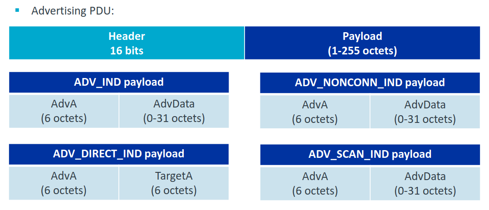

# VSCP over Bluetooth Low Energy (BLE)

> **Status: proposed revision for review.** The legacy version 0 encoding is documented for compatibility. The version 1 encoding, UUID allocation, and security profile in this document are proposals, not registered or deployed interoperability standards. Do not claim conformance to version 1 until these parameters are ratified.

## 1. Scope

VSCP over BLE transports VSCP events using (a) legacy advertising, (b) Bluetooth 5 extended advertising, and (c) connected GATT communication. Advertising is connectionless and provides **no delivery guarantee**. GATT offers bidirectional transfer but does not by itself guarantee application processing. Implementations MUST distinguish the VSCP application event from the BLE advertising data (AD) structure and the link-layer PDU.

Bluetooth LE 5.0 extended advertising is an **optional controller/host capability**: a Bluetooth 5 version number alone does not establish support. LE 2M and LE Coded PHY are separate optional features. Legacy advertising data is limited to 31 octets; extended advertising can use a chain of PDUs, with an advertising data set of up to 1650 octets where supported. A 255-octet extended advertising PDU payload is **not** equivalent to 255 octets of VSCP data.



## 2. Transport profiles

| Profile | BLE mechanism | Intended use | Security |
| --- | --- | --- | --- |
| L0 (legacy) | Legacy advertising, optionally scan response | Compatibility with deployed nodes | Legacy limitations apply |
| E1 (proposed) | Extended advertising, optionally periodic advertising in a future extension | Connectionless measurements, alarms, discovery | Open or authenticated/encrypted |
| G1 (proposed) | Connected GATT service | Configuration, event exchange, register access | Authenticated provisioning and protected writes |

An implementation MAY support several profiles. A receiver MUST NOT interpret an unknown frame version as version 0. Security policy MUST be enforced independently of which profiles a device advertises.

## 3. Bluetooth advertising fundamentals

Advertising data is a series of AD structures: **Length (1 octet), AD Type (1 octet), AD Data (Length - 1 octets)**. Manufacturer Specific Data uses AD Type `0xFF` and begins with a **Bluetooth SIG-assigned Company Identifier**, encoded little-endian. `0xFFFF` is reserved for testing and MUST NOT be used as a production company identifier.

Legacy advertising supports at most 31 octets of advertising data and, separately, up to 31 octets of scan-response data. The legacy `ADV_IND` advertising event is connectable and scannable. A scan request is a BLE link-layer operation; it does **not** contain arbitrary VSCP request payload or a VSCP timestamp. A scan response is not guaranteed to arrive, is not bound transactionally to an individual VSCP event, and MUST NOT be treated as reliable delivery.

Extended advertising uses primary-channel pointers to secondary-channel advertising PDUs. The host/controller handles PDU chaining. Extended advertising and legacy connectable/scannable behavior have different combinations and limitations; an implementation MUST use a controller-supported advertising mode. Periodic advertising and LE Coded PHY are optional and MUST be advertised as capabilities, not presumed.

## 4. Legacy advertising (L0, version 0)

### 4.1 Explicit proposed legacy AD layout

**Compatibility status:** The previous specification described a 16-octet VSCP block, a Company Identifier and flags but did not unambiguously place all fields in the on-air AD structure. The following is a **proposed canonical layout for new L0 implementations**, not a verified claim about every deployed legacy device. Existing firmware and captured advertisements MUST be checked before this layout is declared historically interoperable.

The VSCP data is carried in a Manufacturer Specific Data AD structure (AD Type `0xFF`). Offsets below are measured from the **first byte of this AD structure**, not from the link-layer PDU:

| Offset | Field | Octets | Encoding / value |
| ---: | --- | ---: | --- |
| 0 | AD Length | 1 | `0x14` (20 following octets, including AD Type) |
| 1 | AD Type | 1 | `0xFF` (Manufacturer Specific Data) |
| 2–3 | Company Identifier | 2 | Bluetooth SIG assigned identifier, little-endian |
| 4 | VSCP flags | 1 | Version/encryption bit field, see §4.2 |
| 5–6 | Node ID | 2 | Proposed network byte order (big-endian) |
| 7 | VSCP head | 1 | Low eight bits of VSCP header |
| 8–9 | VSCP class | 2 | Proposed network byte order (big-endian) |
| 10–11 | VSCP type | 2 | Proposed network byte order (big-endian) |
| 12 | Data length | 1 | 0–8 for self-contained advertisement |
| 13–20 | VSCP data | 8 | Event bytes followed by zero padding |

Total: **21 octets** for this AD structure; the VSCP block at offsets 5–20 is exactly **16 octets**. The Company Identifier and flags are **not** part of the encrypted block. When encryption flag bit 7 is set, bytes 5–20 are a single encrypted 16-octet block, and their subfields are interpreted **only after decryption**. This preserves the historical 16-octet encryption-block concept without claiming AES-ECB is secure.

The proposed byte order for the Node ID, class and type is big-endian. The historical text did not specify this byte order explicitly; interoperability with existing firmware MUST be verified before treating it as an established legacy rule.

### 4.2 Flags

| Bit(s) | Meaning |
| --- | --- |
| 0–3 | Frame version; **0** for L0 |
| 4–6 | Reserved; sender MUST set to zero, receiver MUST reject nonzero values under this proposed canonical layout |
| 7 | Encrypted block if 1; plaintext block if 0 |

The frame flags occupy offset 4 in the proposed layout. An L0 receiver MUST NOT mistake this byte for a VSCP header.

### 4.3 AD structure sizing and optional device name

A legacy advertising data set has a maximum of **31 octets**. The manufacturer-specific AD structure above uses 21, leaving **10 octets** for other AD structures. For example, the standard Flags AD structure `02 01 06` uses 3 octets, leaving 7 octets; a Complete Local Name AD structure then has at most 5 name bytes (`Length + Type + 5 bytes`). A longer name MAY instead be placed in scan-response data if supported, or omitted.

**Do not confuse** the standard Bluetooth Flags AD Type `0x01` with the **VSCP flags byte** at offset 4. The old draft's statement that the advertising format was “max 32 bytes” is corrected to **31 advertising data octets**. The name AD Type is `0x09` for Complete Local Name or `0x08` for Shortened Local Name, not the old draft's value 6.

### 4.4 Byte-exact illustrative example (plaintext)

Test-only Company Identifier `0xFFFF`; version 0; no encryption; node ID `0x1234`; head `0x10`; class `0x000A`; type `0x0006`; two data octets `AA BB`:

```text
02 01 06                                  # Standard Bluetooth Flags AD structure
14 FF FF FF 00 12 34 10 00 0A 00 06 02 AA BB 00 00 00 00 00 00
|  |  |     |  |     |  |     |     |  |-----------------------|
|  |  |     |  |     |  |     |     |        8 data octets
|  |  |     |  |     |  |     |     data length = 2
|  |  |     |  |     |  |     type = 0x0006
|  |  |     |  |     |  class = 0x000A
|  |  |     |  |     head = 0x10
|  |  |     |  node ID = 0x1234
|  |  |     VSCP flags = 0x00
|  |  Company ID = 0xFFFF (test only, little-endian)
|  AD Type = 0xFF
AD Length = 0x14
```

The manufacturer AD structure is 21 octets, plus 3 octets for the standard Flags AD structure: **24 of the permitted 31 advertising data octets**. The VSCP block is 16 octets. This is a framing test, not a validated VSCP application-event example. `0xFFFF` MUST NOT be used as a production Company Identifier.

### 4.5 GUID and legacy scan response

The original legacy GUID derivation is `FF:FF:FF:FF:FF:FF:FF:F8:YY:YY:YY:YY:YY:YY:XX:XX`, where `YY` is the BLE address and `XX` is the node ID. The receiver sets `obid` and timestamps as appropriate. This derived GUID is not stable with BLE private-address rotation.

The historical draft claimed that a scan response could carry a timestamp and 16 extra data bytes when the event length is 9–24 bytes. **No canonical scan-response AD structure or event-to-response association was specified.** A BLE scan request contains no application-level VSCP request payload; scan response delivery is not guaranteed. New senders SHOULD limit L0 to 0–8 data bytes unless interoperability with an existing, separately documented extension has been established. A receiver MUST NOT accept an incomplete 9–24-byte event as complete.

### 4.6 Legacy security

AES-128 ECB, when used by historical devices, provides neither event authentication nor replay protection. L0 encrypted frames MUST NOT authorize access control or other privileged operations solely on that basis. Do not infer authentication from the encryption flag.

### Legacy connected devices

The former document lists Name (11 bytes), Key (16 bytes), and Period (1 byte) characteristics without UUIDs, properties, access permissions, or framing. These are **historical descriptions only**, not a complete GATT profile. A generic writable plaintext Key characteristic MUST NOT be introduced in new implementations.

## 5. Proposed extended advertising profile E1

### 5.1 General rules

E1 carries one complete VSCP event in a Manufacturer Specific Data AD structure where possible. For the first interoperable revision, **application-level fragmentation is not supported**: if the encoded event does not fit the configured advertising data set, the sender MUST use G1 or another VSCP transport. Bluetooth controller-managed extended-PDU chaining is permitted. Receivers MUST validate the complete AD structure before parsing and MUST reject malformed lengths, unknown versions, unsupported flags, and duplicate/conflicting fields.

**Wire-order convention:** the Company Identifier is little-endian per Bluetooth; all multioctet VSCP fields and the sequence number are big-endian. The GUID is a 16-octet binary value in VSCP canonical order.

### 5.2 E1 cleartext frame, version 1 (proposed normative encoding)

The following offsets are relative to the **AD Data** portion of the Manufacturer Specific Data AD structure (excluding the outer Length and AD Type octets):

| Offset | Field | Octets | Value / semantics |
| ---: | --- | ---: | --- |
| 0 | Company ID | 2 | Assigned Bluetooth SIG Company Identifier, little-endian |
| 2 | Format version | 1 | `0x01` |
| 3 | Flags | 1 | Bit 0 encrypted; bits 1–7 reserved and MUST be zero |
| 4 | Sequence | 4 | Unsigned monotonic counter, big-endian, scoped to sender/key epoch |
| 8 | GUID | 16 | Stable full VSCP GUID |
| 24 | VSCP head | 2 | Full VSCP header, big-endian |
| 26 | VSCP class | 2 | Big-endian |
| 28 | VSCP type | 2 | Big-endian |
| 30 | Data length | 2 | Big-endian unsigned integer |
| 32 | Event data | N | Exactly N octets |

An unencrypted E1 AD Data value has **32 + N octets**, plus the outer AD Length and AD Type. The sender MUST ensure that the enclosing AD structure fits the selected advertising data set and the one-octet AD Length field. Therefore a single manufacturer AD structure has at most **254 octets of AD Data** and the E1 cleartext event data is limited to **222 octets**. An advertising data set may be larger, but a single AD structure cannot exceed the one-octet AD Length representation. Larger events require another defined encoding or GATT.

Unencrypted E1 is intended for public telemetry/discovery only. It provides neither authenticity nor confidentiality. Consumers MUST NOT authorize privileged actions based on unencrypted E1 events.

### 5.3 E1 encrypted envelope (design reserved; not yet interoperable)

Flag bit 0 is **reserved for a future authenticated-encryption envelope**. Senders MUST set bit 0 to zero until an interoperable envelope with an assigned key ID, unique nonce construction, authentication tag size, authenticated header fields, persistent counter/epoch behavior, key rotation, and test vectors has been ratified. Receivers MUST reject frames with bit 0 set unless they implement that separately ratified extension.

The future profile SHOULD use a constrained-device AEAD such as AES-CCM, authenticate the version, flags, identity, sequence and event metadata as associated data or ciphertext, and define replay protection. AES-ECB MUST NOT be used for E1. A device MUST NOT silently downgrade a command requiring authentication to unencrypted E1.

### 5.4 Identity, sequence and replay

A stable VSCP GUID MUST NOT be derived solely from a rotating BLE private address. The 32-bit sequence counter helps detect duplicates but, without authentication, **does not provide replay security**. Counter wraparound, reboot and key-epoch transitions MUST be specified in the future authenticated profile. Receivers MAY deduplicate cleartext telemetry using (GUID, sequence) within a bounded window; such deduplication is not a security guarantee.

### 5.5 Example byte encoding (proposed; illustrative)

For test-only Company ID `0xFFFF`, version 1, flags 0, sequence 1, GUID `00:01:02:03:04:05:06:07:08:09:0A:0B:0C:0D:0E:0F`, head `0x0000`, class `0x000A`, type `0x0006`, data `11 22`:

```text
AD Length: 0x23 (35 = AD Type 1 + AD Data 34)
AD Type:   FF
AD Data:
  FF FF 01 00 00 00 00 01
  00 01 02 03 04 05 06 07 08 09 0A 0B 0C 0D 0E 0F
  00 00 00 0A 00 06 00 02 11 22
```

This is a **synthetic encoding test**, not a claim that the chosen VSCP class/type/data combination is a valid application event. A production sender MUST replace the test Company ID with its assigned identifier.

## 6. Proposed connected GATT profile G1

G1 SHOULD expose a dedicated VSCP service with these logical characteristics:

| Characteristic | Properties | Purpose |
| --- | --- | --- |
| Capabilities | Read | Supported profiles, frame versions, MTU/size limits, security modes |
| Device GUID | Read | Stable 16-octet GUID |
| Event TX | Notify | Peripheral-to-central framed VSCP events |
| Event RX | Write | Central-to-peripheral framed VSCP events |
| Control | Read/Write/Indicate | Negotiation, status, application errors |
| Configuration | Read/Write | Authorized transport configuration |
| Security status | Read | Provisioning and authorization state |

**UUIDs are intentionally unassigned.** This table is an architecture proposal, not a usable interoperable GATT service. Before publishing G1 as normative, allocate and publish 128-bit UUIDs and specify characteristic permissions, wire frames, ATT MTU handling, fragmentation, credits/flow control, response/error codes, ordering, disconnect behavior, and capability negotiation.

Configuration and command writes MUST require appropriate authenticated authorization. Do not expose plaintext key material via a generic Key characteristic. BLE link encryption alone MUST NOT be assumed to authorize an application-level command; the implementation must enforce its own trust and provisioning policy.

## 7. Security requirements

The following application policy classes are proposed:

| Policy | Requirement | Example |
| --- | --- | --- |
| S0 | No application-layer authenticity | Public temperature telemetry |
| S1 | Authenticated integrity and anti-replay | Trusted alarm reporting |
| S2 | Authenticated encryption and anti-replay | Access control and sensitive configuration |

**Only S0 is currently encoded by the proposed E1 cleartext frame.** S1 and S2 are requirements for future normative security envelopes, not implementations specified by this revision. They MUST define cryptographic algorithms, keys, nonce/counter lifecycle, tag validation, replay windows, rekeying, downgrade resistance, and known-answer tests. A receiver MUST fail closed for an event requiring a higher policy than the received frame provides.

## 8. Interoperability and error handling

An E1 receiver MUST:
1. Parse the outer AD Length and AD Type and verify the manufacturer AD structure is complete.
2. Match the expected Company ID and frame version.
3. Reject any reserved flag bits, encrypted frames without a ratified envelope, or unsupported versions.
4. Verify that the data length equals the exact remaining number of octets.
5. Preserve the 16-octet GUID, full head, class, type and data without reinterpretation.
6. Bound allocations and parsing work to configured resource limits.
7. Never interpret an incomplete or unauthenticated event as an authenticated control command.

A test suite SHOULD include zero-length data, the largest permitted single-AD event, truncated AD structures, off-by-one lengths, invalid version, reserved bits, duplicate sequences, controller feature absence, and legacy-version separation.

## 9. Implementation and compatibility guidance

- Keep existing L0 implementations unchanged unless tested against real deployed traffic.
- Prefer E1 for short, connectionless public events on controllers supporting extended advertising.
- Prefer G1 (once ratified) or another established secure VSCP transport for bidirectional or privileged operations.
- Do not assume every BLE 5 controller supports extended advertising, LE 2M, LE Coded PHY, or periodic advertising.
- Keep the legacy format and new version 1 on separately recognizable frame encodings; do not infer the version from a Bluetooth PHY.
- For large VSCP Level II events, use GATT or another transport until a fully specified fragmentation/large-event encoding is standardized.

## 10. Open standardization decisions

The following MUST be resolved before declaring E1/G1 a final VSCP transport standard:

1. Which assigned Company Identifier or Service Data UUID identifies VSCP on the wire?
2. Is the full GUID required in every E1 advertisement, or is a separately provisioned compact identity mode needed?
3. Which authenticated-encryption envelope and provisioning method will be reused from the broader VSCP security model?
4. Which GATT UUIDs, exact event wire encoding, flow control, and application error model will be standardized?
5. Should large events use multiple AD structures, an application fragment format, or connected transfer only?
6. Which hardware/host combinations form the interoperability reference test matrix?

## 11. References

- [Bluetooth SIG specifications and assigned numbers](https://www.bluetooth.com/specifications/specs/)
- [Bluetooth Core Specification](https://www.bluetooth.com/specifications/specs/core-specification/)
- [VSCP specification repository](https://github.com/grodansparadis/vscp-doc-spec)
- [VSCP Bluetooth mesh transport](./vscp_over_bt_mesh.md)

[filename](./bottom_copyright.md ':include')
