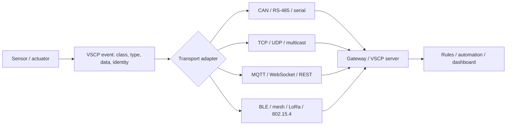
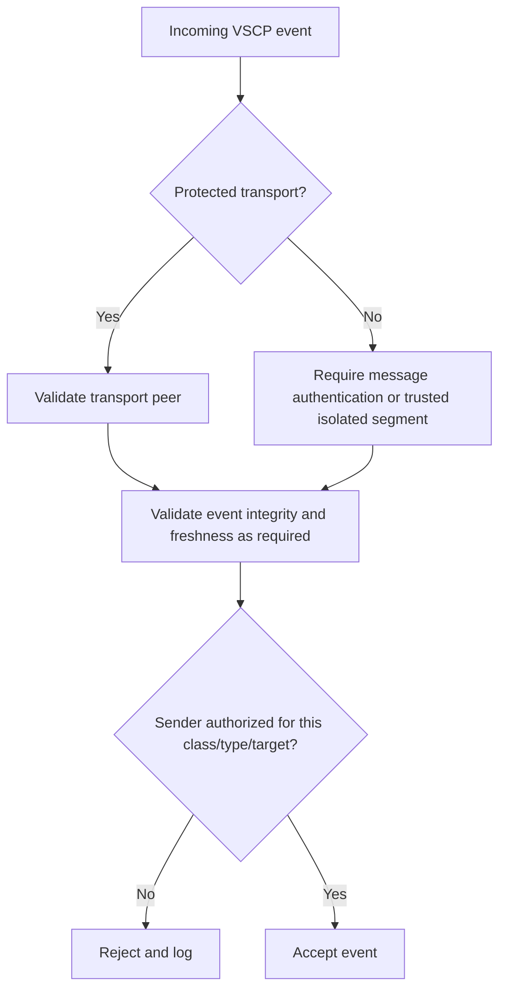
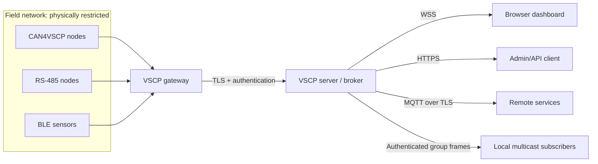
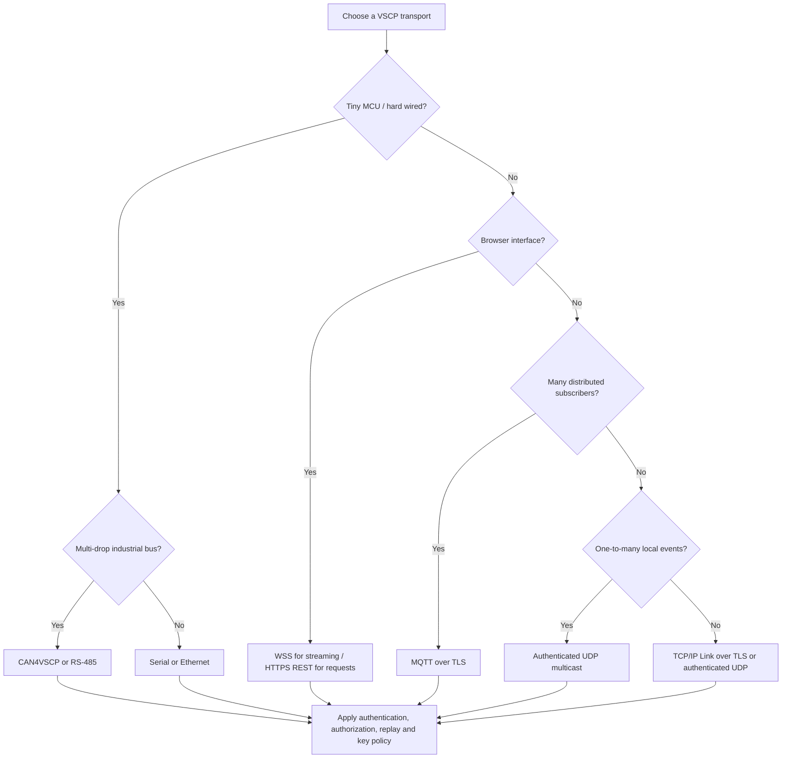

# VSCP Transport and Security Guide

**Technical comparison and deployment guidance**  
**Date:** 2026-11-19  
**Status:** Engineering guide; verify exact implementation support against the version deployed.

## 1. Executive summary

VSCP (Very Simple Control Protocol) is an application-level event framework that can operate over multiple physical links and application transports. The transport determines reach, topology, latency, and many practical security controls; it does **not** by itself determine whether a VSCP event is trustworthy.

**Recommended starting points:** CAN4VSCP for small deterministic wired nodes; RS-485 for inexpensive long wired runs; MQTT over TLS for brokered IoT deployments; TCP/IP Link over TLS for persistent server/client communication; WSS for browser dashboards; HTTPS REST for occasional administrative requests; authenticated UDP or multicast for efficient local event distribution when the implementation and key management are verified.

> **Security warning:** An encrypted frame is not necessarily an authenticated frame. Likewise, a physically wired bus is not inherently secure. Evaluate confidentiality, integrity, sender authentication, replay resistance, authorization, key provisioning, and firmware-update security independently.

## 2. Architecture: the same VSCP event across different networks

VSCP Level I is designed for constrained devices and compact links; Level II supports richer event representation and networking. A gateway can translate between transports without changing the application's fundamental event semantics, but it must enforce security policies across trust boundaries.

## 3. Security vocabulary and levels

The levels below are **deployment assessment categories**, not official numbered VSCP security levels.

| Category | Meaning | Typical controls |
|---|---|---|
| S0: Unprotected | No cryptographic confidentiality or source authentication | Physical isolation only |
| S1: Perimeter-protected | Access limited by network or physical boundary | VLAN, firewall, controlled wiring, VPN |
| S2: Channel-protected | Connection/link encryption and usually peer authentication | TLS, BLE authenticated pairing, link-layer security |
| S3: Message-authenticated | Individual frames have cryptographic integrity/authentication | HMAC, authenticated encryption with managed keys |
| S4: Managed secure system | S2/S3 plus identity, authorization, replay defense, rotation and monitoring | Provisioning, ACLs, counters/nonces, secure boot |

A system may combine categories. TLS normally protects a connection, not an event once it leaves that connection. HMAC authenticates data but **does not encrypt it**. AES encryption alone does not establish authenticity; the selected mode and frame format matter. Replay protection must be explicitly checked rather than assumed.

## 4. Transport comparison

**Ease:** 1 = easiest, 5 = hardest, for a small working deployment; hardware and operations can change the rating. **Native security** describes the underlying transport or its standard secure variant, not guaranteed VSCP software behavior.

| Transport | Typical topology | Native / practical protection | Ease | Best use | Main caveat |
|---|---|---|---:|---|---|
| **CAN / CAN4VSCP** | Multi-drop wired bus | No standard CAN confidentiality or sender authentication | 3 | Low-cost real-time control, embedded nodes | Any bus participant can inject frames unless additional controls exist |
| **RS-485 / RS-422 Level I** | Wired multidrop / point-to-point | None inherent | 3 | Long industrial wiring, modest bandwidth | Bus access and collision/turnaround management |
| **RS-232 / serial** | Point-to-point | None inherent | 2 | Local device integration, debugging | Limited distance; serial port is a trust boundary |
| **Raw Ethernet** | Local Ethernet segment | No application-layer security inherent; frame protection possible in newer VSCP implementations | 4 | LAN experiments, gateway links | Layer-2 reach only; switch/VLAN behavior |
| **TCP/IP Link** | Persistent client/server | TLS where supported/configured; optional VSCP binary frame protection | 2–3 | Servers, gateways, remote configuration | Verify TLS certificate validation and authentication |
| **UDP unicast** | Datagram point-to-point | No security inherent; VSCP frame protection where implemented | 2–3 | Low-overhead telemetry and events | Loss, ordering, spoofing, replay |
| **UDP multicast** | One-to-many datagrams | No security inherent; group message protection where implemented | 4 | LAN event distribution, many listeners | Group-key compromise, routing, replay, no delivery guarantee |
| **WebSocket** | Persistent browser/app connection | WSS (TLS) | 2 | Live dashboards and interactive clients | Browser auth, origin checks, authorization |
| **REST / HTTP** | Request/response | HTTPS (TLS) | 1–2 | Configuration, occasional queries, integrations | Polling overhead; unsuitable for tight real-time loops |
| **MQTT** | Brokered publish/subscribe | MQTT over TLS, broker authentication/ACLs | 2–3 | Cloud/edge IoT, many consumers | Broker trust and topic-level permissions |
| **BLE** | Short-range wireless | BLE pairing/bonding and link encryption, when configured | 3–4 | Battery-powered sensors, phone commissioning | Advertising is not automatically encrypted |
| **Bluetooth Mesh** | Wireless mesh | Mesh network/application keys and replay controls | 4–5 | Distributed lighting/building sensors | Provisioning and key lifecycle complexity |
| **LoRa** | Long-range low-rate wireless | Depends on framing/protocol; LoRa radio alone is not secure | 4–5 | Remote low-data-rate sensors | Airtime, duty cycle, message size, keys |
| **IEEE 802.15.4 / 6LoWPAN** | Low-power wireless mesh | Link-layer AES-based security when enabled; higher-layer options | 4–5 | Sensor meshes, constrained IPv6 networks | Network stack and provisioning complexity |
| **Generic binary protocol (GBP)** | Framing over suitable links | Depends on selected frame mode and implementation | 3–5 | Compact binary exchange and bridging | Framing is not itself a secure transport |
| **Low-bandwidth / specialized models** | Constrained or specialized links | Varies by carrier and frame profile | 4–5 | Niche embedded and radio applications | Check each profile individually |

### Notes on additional specification entries

The VSCP specification navigation also lists **Dumb nodes**, **Droplet model**, **BumbleBeez Protocol**, and **VSCP Text**. These are not necessarily peers of TCP, CAN, or BLE in a strict OSI-layer comparison: some describe device models, encodings, or specialized profiles. They should be evaluated according to their underlying bearer and actual frame/security implementation rather than assigned an invented encryption guarantee.

## 5. Practical recommendations by scenario

| Scenario | Preferred option | Security baseline |
|---|---|---|
| Tiny MCU controlling relays | CAN4VSCP | Isolated bus, secure gateway, device/command authorization |
| Factory wiring over tens/hundreds of meters | RS-485 | Restricted physical access; authenticated commands if exposed |
| Linux VSCP gateway | TCP/IP Link with TLS | Validated server certificate, client identity, firewall |
| Live web UI | WSS | TLS, authenticated session, origin and authorization checks |
| Enterprise/cloud telemetry | MQTT over TLS | Per-device credentials and narrowly scoped topic ACLs |
| LAN-wide event notifications | Authenticated multicast | Group-key management, freshness checking, rate limits |
| Simple remote configuration | HTTPS REST | TLS, authentication, authorization, audit logging |
| Battery sensor with phone | BLE | Secure pairing for connections; no secrets in plain advertisements |
| Long-distance sparse telemetry | LoRa-based VSCP profile | Authenticated payloads, anti-replay, constrained payload sizes |
| Wireless sensor mesh | Bluetooth Mesh / 802.15.4 | Secure provisioning and network/application key lifecycle |

## 6. Detailed transport considerations

### 6.1 CAN4VSCP

CAN is attractive for small controllers because of arbitration, robust error handling, and widely available controllers/transceivers. Level I can use compact node nicknames rather than transmitting a full 128-bit GUID on every frame. **CAN identifiers are not cryptographic identities.** Place high-impact actuation behind trusted gateways or add a verified application security scheme where resources allow.

### 6.2 Serial, RS-232, RS-485 and RS-422

Serial transports are understandable and inexpensive. RS-485 is well suited to multi-drop industrial installations; RS-232 is useful for local point-to-point connections. UART framing, CRC, and physical noise resistance are not cryptographic authentication. Treat maintenance ports and USB-to-serial bridges as possible attack entry points.

### 6.3 TCP/IP Link

A persistent VSCP Link connection is convenient for gateways and applications. Prefer TLS with certificate validation and explicit client permissions. The VSCP codebase added selectable TLS support and binary frame work during 2026; confirm that the specific client and daemon versions actually implement and enforce the intended options.

### 6.4 UDP and multicast

UDP is efficient but does not guarantee delivery, order, or unique reception. Multicast avoids N separate transmissions for N listeners, but security is harder: recipients commonly share keys, and one compromised member can threaten the group. Use authenticated frames, key identifiers/rotation, replay windows, bounded packet sizes, and multicast network scoping. Do not equate encryption with sender-specific authorization.

### 6.5 MQTT

MQTT is often the easiest path to scalable event distribution because brokers provide subscriptions and access-control mechanisms. Use TLS, per-device identities, and least-privilege topic ACLs. Broker-side permissions and any VSCP event-level authorization are separate controls. Check message delivery semantics and duplicate handling for actuation.

### 6.6 WebSocket and REST

WebSocket is ideal for continuous live UI updates; REST is ideal for occasional request/response operations. Use **WSS** and **HTTPS** respectively, with application authentication, fine-grained authorization, input validation, and appropriate browser protections. Neither should be treated as automatically safe merely because TLS is enabled.

### 6.7 BLE and Bluetooth Mesh

BLE connections can use link security, but ordinary advertisements are broadcast and typically readable by nearby receivers. Bluetooth Mesh has its own provisioning and key hierarchy. Distinguish connected BLE event delivery from advertising-based event delivery; the security and payload constraints differ substantially.

### 6.8 LoRa, IEEE 802.15.4, and specialized radio transports

LoRa is a radio modulation, not automatically a secure application protocol. IEEE 802.15.4 has security capabilities, but configuration, key handling, and higher-layer protocol choice determine real protection. Battery budgets, airtime, message fragmentation, and loss recovery often matter more than raw throughput.

### 6.9 Raw Ethernet, GBP, and text encoding

Raw Ethernet is useful within a broadcast domain but is not routable like IP. GBP and text representations concern framing/encoding; they can be carried by other channels. Newer VSCP binary frame mechanisms include encryption and authenticated variants, but the exact protection must be selected and validated at both ends.

## 7. VSCP-specific security and version caveats

Recent official release notes report:

- **September 2026:** selectable TLS for TCP clients and servers and a general binary encrypted protocol used with Link, UDP, multicast, and raw Ethernet.
- **November 2026:** HMAC-SHA-256 authenticated version 1 binary frames, frame interoperability tests, and additional TCP binary mode work.

These are **implementation milestones**, not evidence that every VSCP transport, daemon, library, or device automatically has the features enabled. Before claiming authenticated/encrypted transport support, check the frame version, cryptographic mode, key configuration, peer verification, test vectors, and deployed component versions.

### Security checklist

- [ ] Inventory every transport and gateway crossing.
- [ ] Identify which commands can affect physical safety or equipment.
- [ ] Require authenticated senders for sensitive events.
- [ ] Use encryption where confidentiality is required.
- [ ] Validate replay resistance, including after reboot.
- [ ] Provision distinct device credentials where feasible.
- [ ] Enforce authorization at the gateway/broker/application.
- [ ] Plan key rotation, revocation, and secure firmware updates.
- [ ] Test malformed frames, duplicate messages, and loss/reordering.
- [ ] Confirm TLS certificate validation, not merely TLS negotiation.

## 8. Illustration: a mixed-transport deployment

**Trust-boundary rule:** A gateway should not promote an unauthenticated field-bus event into a privileged cloud command merely because the outbound connection uses TLS. Source trust and authorization must be decided separately.

## 9. Transport selection flowchart

## 10. Sources and further reading

1. [Official VSCP specification repository](https://github.com/grodansparadis/vscp-doc-spec)
2. [VSCP specification transport table of contents](https://github.com/grodansparadis/vscp-doc-spec/blob/master/_main_sidebar.md)
3. [VSCP documentation portal](https://docs.vscp.org/)
4. [VSCP core repository](https://github.com/grodansparadis/vscp)
5. [VSCP releases — 2026 TLS, binary framing and HMAC changes](https://github.com/grodansparadis/vscp/releases)
6. [VSCP Level I firmware specifics](https://github.com/grodansparadis/vscp-doc-firmware/blob/master/level1_specifics.md)

**Scope note:** Ratings and scenario recommendations are engineering assessments, not normative claims from the specification. Some entries in the specification are transport profiles or encodings rather than independent physical networks. For a standards-level security matrix, each transport's exact specification chapter and implementation version should be audited individually.
